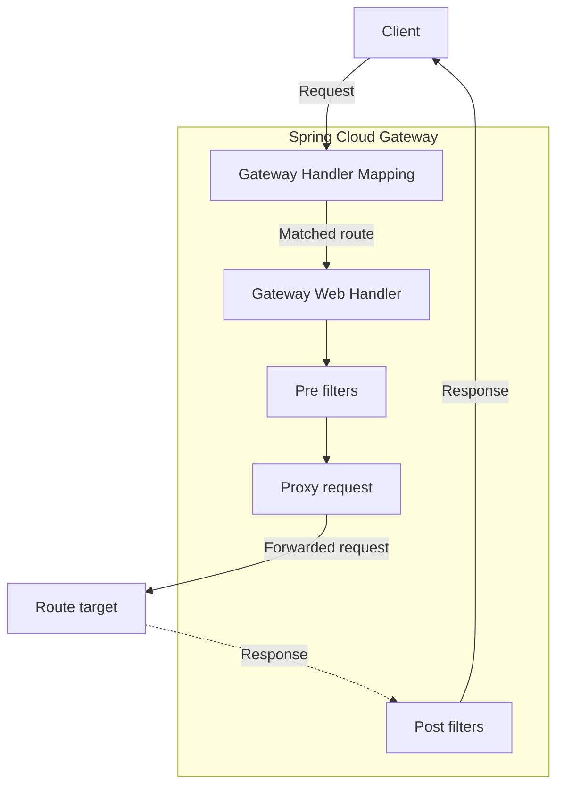

# 总览

该项目提供了一个基于 Spring 构建 API 网关的库。Spring Cloud Gateway 旨在提供一种简单而有效的方式来路由 API，并为 API 提供诸如安全性、监控/指标和弹性等横切关注点。


## 功能

Spring Cloud Gateway 功能：

- 基于 Spring Framework 和 Spring Boot 构建
- 同时兼容 Spring WebFlux 和 Spring Web MVC
- 能够根据任何请求属性匹配路由
- `Predicate` 和 `Filter` 是路由特有的
- Spring Cloud Circuit Breaker 集成
- Spring Cloud DiscoveryClient 集成
- 易于编写 `Predicate` 和 `Filter`
- 请求速率限制
- 路径重写


## Spring Cloud Gateway Server WebFlux 入门

```java
@SpringBootApplication
public  class DemogatewayApplication {
  @Bean
  public RouteLocator customRouteLoator(RouteLocatorBuilder builder) {
    return builder.routes()
      .route("path_route", r -> r.path("/get")
             .uri("https://httpbin.org"))
      .route("host_route", r -> r.host("*.myhost.org")
             .uri("https://httpbin.org"))
      .route("rewrite_route", r -> r.host("*.myhost.org")
             .filters(f -> f.rwritePath("/foo/(?<segment>.*)", "/${segment}"))
             .uri("https://httpbin.org"))
      .route("circuit_breaker_route", r -> r.host("*.circuitbreaker.org")
             .filters(f -> f.circuitBreaker(c -> c.setName("slowcmd").setFallbackUri("forward:/circuirbreakerfallback")))
             .uri("https://httpbin.org"))
      .route("limit_route", r -> r.host("*.limited.org").and().path("/anything/**")
             .filters(f -> f.requestRateLimiter(c -> c.setRateLimiter(redisRateLimiter())))
             .uri("https://httpbin.org"))
      .build();
  }
}
```

要运行你自己的 Gateway Server Webflux，请使用 `sring-cloud-starter-gateway-server-webflux` 依赖。


## Spring Cloud Gateway Server Web MVC 入门

```java
import static org.springframework.cloud.gateway.server.mvc.handler.GatewayRouterFunction.route;
import static org.springframework.cloud.gateway.server.mvc.filter.BeforeFilterFunctions.*;
import static org.springframework.cloud.gateway.server.mvc.predicate.GatewayRequestPredicates.*;

@SpringBootApplication
public  class DemogatewayApplication {
  @Bean
  public RouterFunction<ServerResponse> customRoutes() {
    return route("path_route")
      	.GET("/get", http())
      	.before(uri("https://httpbin.org"))
      .build().and(route("host_route")
       	.route(host("*.myhost.org"), http())
       	.before(uri("https://httpbin.org"))
      .build().and(route("rewrite_route")
       	.route(host("*.rewrite.org"), http())
       	.before(uri("https://httpbin.org"))
        .before(rewritePath("/foo/(?<segment>.*)", "/${segment}"))
      .build().and(route("circuit_breaker_route")
       	.route(host("*.circuitbreaker.org"), http())
       	.before(uri("https://httpbin.org"))
        .filter(circuitBreaker("slowcmd"))
      .build().and(route("limit_route")
       	.route(host("*.limited.org").and(path("/anything/*")), http())
       	.before(uri("https://httpbin.org"))
        .filter(rateLimit(c -> c.setCapacity(10).setPeriod(Duration.ofSeconds(1)).setKeyResolver(request -> request.headers().firstHeader("X-TokenId"))))
       .build()))));
  }
}
```

要运行你自己的 Gateway Server WebMVC，请使用 `sring-cloud-starter-gateway-server-webmvc` 依赖。


# 介绍


## Spring Cloud Gateway

本项目提供了一个基于 Spring 生态系统的 API 网关，包括 Spring Framework 7、Spring Boot 4 和 Project Reactor。Spring  Cloud Gateway 旨在提供一种简单而高效的方式来路由 API，并为 API 提供诸如安全性、监控/指标和弹性等横切关注点。

Spring Cloud Gateway 有两种不同的版本：`Server` 和 `Proxy Exchange`。每种版本都兼容 `WebFlux` 和 `Web MVC`。

- `Server` 是一个功能齐全的 API 网关，可以独立运行，也可以嵌入到 Spring Boot 应用程序中
- `Proxy Exchange` 专门用于基于注解的  WebFlux 或 Web MVC 应用程序，并允许使用特殊的 `ProxyExchange` 对象作为 Web 处理程序方法的参数。


# Spring Cloud Gateway Server WebFlux


## 如何引入 Spring Cloud Gateway

要将 Spring Cloud Gateway 集成到你的项目中，请使用 group ID 为 `org.springframework.cloud`，arthfact ID 为 `spring-cloud-starter-gateway-server-webflux` 的 starter。有关如何使用当前 Spring Cloud 版本配置构建系统的详细信息，请参阅 Spring Cloud 项目页面。

如果你包含了 starter，但你不想启用网关，请设置 `spring.cloud.gateway.enabled=false`。

> Spring Cloud Gateway 构建于 Spring Boot、Spring WebFlux 和 Project Reactor 之上。因此，许多你熟悉的同步库（例如 Spring Data 和 Spring Security）和模式可能不适用于 Spring Cloud Gateway。如果你不熟悉这些项目，我们建议你先阅读它们的文档，熟悉一些新概念，然后再开始使用 Spring Cloud Gateway。

> Spring Cloud Gateway 需要 Spring Boot 和 Spring Webflux 提供的 Netty 运行时环境。它无法在传统的 Servlet 容器中运行，也无法以 WAR 包的形式构建。


## 词汇表

- **Route**: 网关的基本组成部分。它由一个 ID、一个目标 URI、一组 `Predicate` 和一组 `Filter` 定义。如果聚合 `Predicate` 为真，则路由匹配成功。
- **Predicate**: 这是 Java 8 的 `Function Predicate`。输入类型是 Spring Framework `ServerWebExchange`，这允许你匹配 HTTP 请求中的任何内容，例如标头或参数。
- **Filter**: 这些是使用特定工厂创建的 `GatewayFilter` 实例。你可以在此处修改下游请求之前或之后的请求和响应。


## 工作原理

下图概述了 Spring Cloud Gateway 的工作原理：



客户端向 Spring Cloud Gateway 发出请求。如果 Gateway Handler Mapping 确定请求与某个路由匹配，则该请求会被发送到 Gateway Web Handler。该 Handler 会根据请求的具体请求，通过一系列过滤器来处理请求。过滤器之间用虚线分割，是因为过滤器可以在代理请求发送之前和之后执行逻辑。首先执行所有 "pre" 过滤器，然后发出代理请求。代理请求发出后，运行 "post" 过滤器。

> 路由中定义的未指定端口的 URI，HTTP URI 的默认端口值为 80，HTTPS  URI 的默认端口值为 443。

> 路由 URI 上定义的任何路径将被忽略。


## 配置路由 Predicate 工厂和网关 Filter 工厂

配置 `Predicate` 和 `Filter` 有两种方法：快捷方式或完全展开的参数。以下大多数示例都使用快捷方式。

名称和参数名称已 `code` 形式列在每个部分的开头或结尾。参数通常按照快捷配置所需的顺序排列。


### 快捷配置

快捷配置通过过滤器名称来识别，后跟等号（`=`），再后跟逗号（`,`）分割的参数值。

*application.yml*

```yaml
spring:
	cloud:
		gateway:
			server:
				webflux:
					routes:
					- id: after_route
						uri: https://example.org
						predicates:
						- Cookie=mycookie,mycookievalue
```

前面的示例定义了 `Cookie` 路由 `Predicate` 工厂，它有两个参数：cookie 名称 `mycookie` 和要匹配的值 `mycookievalue`


### 完全展开参数

完全展开的参数看起来更像是标准的 YAML 配置，包含键值对。通常，会有一个 `name` 键和 `args` 键。`args` 键时一个键值对映射，用于配置 `Predicate` 或 `Filter`。

*application.yml*

```yaml
spring:
	cloud:
		gateway:
			server:
				webflux:
					routes:
					- id: after_route
						uri: https://example.org
						predicates:
						- name: Cookie
							args:
								name: mycookie
								regexp: mycookievalue
```

这是上面所示的 `Cookie` `Predicate` 的快捷方式配置的完整配置。


## 路由 Predicate 工厂

Spring Cloud Gateway 作为 Spring WebFlux `HandlerMapping` 基础架构的一部分，负责路由匹配。Spring Cloud Gateway 内置了许多路由 `Predicate` 工厂。所有这些 `Predicate` 都匹配 HTTP 请求的不同属性。你可以使用逻辑 `and` 语句组合多个路由 `Predicate` 工厂 。


### After 路由 Predicate 工厂

`After` 路由 `Predicate` 工厂接受一个参数，即 `datetime`（Java `ZonedDateTime` 类型）。此 `Predicate` 匹配指定日期时间之后发生的请求。以下示例配置了一个 `After` `Predicate`：

*application.yml*

```yaml
spring:
	cloud:
		gateway:
			server:
				webflux:
					routes:
					- id: after_route
						uri: https://example.org
						predicates:
						- After=2017-01-20T17:42:47.789-07:00[America/Denver]
```

该路由将与 2017 年 1 月 20 日 17:42 （丹佛山区时间）之后发出的任何请求相匹配。


### Before 路由 Predicate 工厂

`Before` 路由 `Predicate` 工厂接受一个参数，即 `datetime`（Java `ZonedDateTime` 类型）。此 `Predicate` 匹配指定日期时间之前发生的请求。以下示例配置了一个 `Before` `Predicate`：

*application.yml*

```yaml
spring:
	cloud:
		gateway:
			server:
				webflux:
					routes:
					- id: before_route
						uri: https://example.org
						predicates:
						- Before=2017-01-20T17:42:47.789-07:00[America/Denver]
```

该路由将与 2017 年 1 月 20 日 17:42 （丹佛山区时间）之前发出的任何请求相匹配。


### Between 路由 Predicate 工厂

`Between` 路由 `Predicate` 工厂接受两个参数，即 `datetime1` 和 `datetime2`（Java `ZonedDateTime` 类型）。此 `Predicate` 匹配指定发生在 `datetime1` 之后，`datetime2` 之前之前的请求。`datetim2` 参数必须晚于 `datetime1`。以下示例配置了一个 `Between` `Predicate`：

*application.yml*

```yaml
spring:
	cloud:
		gateway:
			server:
				webflux:
					routes:
					- id: between_route
						uri: https://example.org
						predicates:
						- Between=2017-01-20T17:42:47.789-07:00[America/Denver], 2017-01-21T17:42:47.789-07:00[America/Denver]
```

此路由将匹配 2017 年 1 月 20 日 17:42 （丹佛山区时间）之后至 2017 年 1 月 21 日 17:42 （丹佛山区时间）之前发出的所有请求。这对于维护窗口非常有用。


### Cookie 路由 Predicate 工厂

`Cookie` 路由 `Predicate` 工厂接受两个参数：Cookie `name` 和 `regexp`（Java 正则表达式）。此 `Predicate` 匹配具有给定名称且值与正则表达式匹配的 Cookie。以下示例配置了一个 `Cookie` `Predicate`:

*application.yml*

```yaml
spring:
	cloud:
		gateway:
			server:
				webflux:
					routes:
					- id: cookie_route
						uri: https://example.org
						predicates:
						- Cookie=chocolate, ch.p
```

此路由匹配名为 `chocolate` 的 cookie 的请求，该 cookie 的值与 `ch.p` 正则表达式匹配。


### Header 路由 Predicate 工厂

`Header` 路由 `Predicate` 工厂接受两个参数：`header` 和 `regexp`（Java 正则表达式）。此 `Predicate` 匹配具有给定名称且值与正则表达式匹配的标头。以下示例配置了一个 `Header` `Predicate`:

*application.yml*

```yaml
spring:
	cloud:
		gateway:
			server:
				webflux:
					routes:
					- id: header_route
						uri: https://example.org
						predicates:
						- Header=X-Request-Id, \d+
```

如果请求具有名为 `X-Request-Id` 的标头，且其值与 `\d+` 正则表达式匹配（即，其值为一个或多个数字），则此路由匹配。


### Host 路由 Predicate 工厂

`Host` 路由 `Predicate` 工厂接受一个参数：主机名 `patterns` 列表。该模式是 Ant 风格的模式，以`.` 作为分隔符。此 `Predicate` 匹配与该模式匹配的 `Host` 标头。以下示例配置了一个 `Host` `Predicate`:

*application.yml*

```yaml
spring:
	cloud:
		gateway:
			server:
				webflux:
					routes:
					- id: host_route
						uri: https://example.org
						predicates:
						- Host=**.somehost.org,**.anotherhost.org
```

同时支持 URI 模板变量（例如 `{sub}.myhost.org`）。

如果请求的 `Host` 标头值为 `www.somehost.org` 或 `beta.somehost.org` 或 `www.anotherhost.org`，则此路由匹配。

此 `Predicate` 将 URI 模板变量（例如前面示例中定义的 `sub`）提取为名称和值的映射，并 将其放入 `ServerWebExchange.getAttributess()` 中，键由 `ServerWebExchangeUtils.URL_TEMPLATE_VARIABLES_ATTRIBUTE` 定义。然后，这些值可供 `GatewayFilter` 工厂使用。


### Method 路由 Predicate 工厂

`Method` 路由 `Predicate` 工厂接受一个名为 `methods` 的参数，该参数包含一个或多个参数：要匹配的 HTTP 方法。以下示例配置了一个 `Method` `Predicate`：

*application.yml*

```yaml
spring:
	cloud:
		gateway:
			server:
				webflux:
					routes:
					- id: method_route
						uri: https://example.org
						predicates:
						- Method=GET,POST
```

如果请求方法是 `GET` 或 `POST`，此路由则匹配。


### Path 路由 Predicate 工厂

`Path` 路由 `Predicate` 工厂接受两个参数：一个 Spring `PathMatcher` `patterns` 和 一个可选标志 `matchTrailingSlash`（默认为 true）。以下示例配置了一个 `Path` `Predicate`:

*application.yml*

```yaml
spring:
	cloud:
		gateway:
			server:
				webflux:
					routes:
					- id: path_route
						uri: https://example.org
						predicates:
						- Path=/red/{segment},/blue/{segment}
```

如果请求路径为 `/red/1` 或 `/red/1/` 或 `/red/blue` 或 `/red/green`，则此路由匹配。

如果 `matchTrailingSlash`  设置为 `false`，则请求路径 `/red/1/` 将不会被匹配。

#### 完全展开参数

当使用完全展开的参数格式时（例如，通过 Actuator API 或已编程方式配置路径时），`Path` `Predicate` 使用索引键来表示列表参数。以下示例展示了完全展开的配置：

*application.yml*

```yaml
spring:
	cloud:
		gateway:
			server:
				webflux:
					routes:
					- id: path_route
						uri: https://example.org
						predicates:
						- name: Path
							args:
								patterns.0: /red/{segment}
								patterns.1: /blue/{segment}
								matchTrailingSlash: false
```

通过 Actuator API 发布路由定义时，请在 JSON 请求正文中使用相同的索引表示法：

```json
{
  "id": "path_route",
  "uri": "https://example.org",
  "predicates": [
    {
      "name": "path",
      "args": {
        "patterns.0": "/red/{segment}",
        "patterns.1": "/blue/{segment}",
        "matchTrailingSlash": "false",
      }
    }
  ]
}
```

> `args` 映射仅接受字符串键值对。列表参数（例如 `patterns`）必须使用索引键（`patterns.0`、`patterns.1`等）指定，而不是 JSON 数组。配置 `Predicate` 时，这种索引表示法会自动转换为 `List<String>`。

如果你已经设置了 `spring.webflux.base-path` 属性，这将影响路径匹配。该属性值将自动添加到路径模式的前面。例如，如果 `spring.webflux.base-path=/app` 且路径模式为 `/red/{segment}`，则用于匹配的完整模式将为 `/app/red/{segment}`。

此 `Predicate` 将 URI 模板变量（例如前面示例中定义的 `segment`）提取为名称和值的映射，并 将其放入 `ServerWebExchange.getAttributess()` 中，键由 `ServerWebExchangeUtils.URL_TEMPLATE_VARIABLES_ATTRIBUTE` 定义。然后，这些值可供 `GatewayFilter` 工厂使用。

为了方便访问这些变量，我们提供了一个名为 `get` 的实用方法。以下示例展示了 如何使用 `get` 方法：

```yaml
Map<String, String> uriVariables = ServerWebExchangeUtils.getUriTemplateVariables(exchange);

String segmen = uriVariables.get(*"segment");
```


### Query 路由 Predicate 工厂

`Query` 路由 `Predicate` 工厂接受两个参数：一个必需 `param`  和 一个可选标志 `regexp`（Java 正则表达式）。以下示例配置了一个 `Query` `Predicate`:

*application.yml*

```yaml
spring:
	cloud:
		gateway:
			server:
				webflux:
					routes:
					- id: query_route
						uri: https://example.org
						predicates:
						- Query=green
```

如果请求中包含 `green` 查询参数，则 上述路由匹配。

*application.yml*

```yaml
spring:
	cloud:
		gateway:
			server:
				webflux:
					routes:
					- id: query_route
						uri: https://example.org
						predicates:
						- Query=red, gree,
```

如果请求中包含 `red` 请求参数，且该参数的值与 `gree.` 正则表达式匹配，则前面的路由匹配，因此 `green` 和 `greet` 会匹配。


### RemoteAddr 路由 Predicate 工厂

`RemoteAddr` 路由 `Predicate` 工厂接受一个 `sources` 列表（最小长度为 1），`source` 是 CIDR 表示法（IPv4 或 IPv6）字符串，例如 `192.168.0.1/16` （其中 `192.18.0.1` 是 IP 地址，`16`  是子网掩码）。以下示例配置了一个 `RemoteAddr` `Predicate`:

*application.yml*

```yaml
spring:
	cloud:
		gateway:
			server:
				webflux:
					routes:
					- id: remoteaddr_route
						uri: https://example.org
						predicates:
						- RemoteAddr=192.168.1.1/24
```

如果请求的远程地址是例如 `192.168.1.1`，则此路由匹配。

#### 修改远程地址解析方式

默认情况下，`RemoteAddr`  路由 `Predicate` 工厂使用传入请求中的远程地址。如果 Spring Cloud Gateway 位于代理层之后，则此地址可能与实际客户端 IP 地址不匹配。

你可以通过设置自定义的 `RemoteAddrResolver` 来定制远程地址的解析方式。Spring Cloud Gateway 提供了一个基于 `X-Forwarded-For` 标头的非默认远程地址解析器，及 `XForwardedRemoteAddressResolver`。

`XForwardedRemoteAddressResolver` 有两个静态构造函数，它们采用了不同的安全方法：

- `XForwardedRemoteAddressResolver::trustAll` 返回一个 `RemoteAddrResolver`，该解析器始终接受 `X-Forwarded-For` 标头中找到的第一个 IP 地址。这种方法容易受到欺骗，因为恶意客户端可以为 `X-Forwarded-For` 设置一个初始值，而解析器会接受该值。
- `XForwardedRemoteAddressResolver::maxTrustedIndex` 参数接受一个索引值，该索引值与 Spring Cloud Gateway 前端运行的受信任基础设施的数量相关。例如，如果 Spring Cloud Gateway 只能通过 HAProxy 访问，则应使用值 1。如果需要经过两跳受信任基础设施才能访问 Spring Cloud Gateway，则应使用值 2。

请考虑以下标头值：

```
X-Forwarded-For: 0.0.0.1, 0.0.0.2, 0.0.0.3
```

以下 `maxTrustedIndex` 值会生成以下远程地址：

| maxTrustedIndex          | 结果                                              |
| ------------------------ | ------------------------------------------------- |
| [`Integer.MIN_VALUE`, 0] | (非法，初始化期间抛出 `IllegalArgumentException`) |
| 1                        | 0.0.0.3                                           |
| 2                        | 0.0.0.2                                           |
| 3                        | 0.0.0.1                                           |
| [4, `Integer.MAX_VALUE`] | 0.0.0.1                                           |

以下示例展示了如何使用 Java 实现相同的配置：

*GatewayConfig.java*

```java
RemoteAddressResolver resolver = XForwardedRemoteAddressResolver.maxTrustedIndex(1);
...
  
.route("direct_route",
      r -> r.remoteAddr("10.1.1.1", "10.1.1.1/24")
      	.uri("https://downstream1"))
// TODO 原文格式错误
.route("proxied-route", 
      r -> r.remoteAddr(resolver, "10.10.1.1", "10.10.1.1/24")
       	.uri("https://downstream2")
)
```


### Weight 路由 Predicate 工厂

`Weight` 路由 `Predicate` 工厂接受两个参数：一个必需 `group`  和 一个可选标志 `weight`（整数）。权重是按组计算的，以下示例配置了一个 `Weight` `Predicate`:

*application.yml*

```
spring:
	cloud:
		gateway:
			server:
				webflux:
					routes:
					- id: weight_high
						uri: https://weighthigh.org
						predicate:
						- weight:group1, 8
					- id: weight_low
						uri: https://weightlow.org
						predicate:
						- weight:group1, 2
```

该路由会将大约 `80%` 的流量转发到 `weighthigh.org`，将大约 `20%` 的流量转发到 `weightlow.org`。


### XForwarded 远程地址路由 Predicate 工厂

`XForwadrded Remote Addr` 路由 `Predicate` 工厂接受一个 `sources` 列表（最小长度为 1），`source` 是 CIDR 表示法（IPv4 或 IPv6）字符串，例如 `192.168.0.1/16` （其中 `192.18.0.1` 是 IP 地址，`16`  是子网掩码）。

此路由 `Predicate` 允许根据 `X-Forwarded-For` HTTP 标头过过滤请求。

这可以与反向代理（例如负载均衡器或 Web 应用程序防火墙）一起使用，只有来自这些反向代理使用的受信任 IP 地址列表的请求才应被允许。

以下示例配置 `XForwardedRemoteAddr` 路由 `Predicate`:

*application.yml*

```yaml
spring:
	cloud:
		gateway:
			server:
				webflux:
					routes:
					- id: xforwarded_remoteaddr_route
						uri: https://example.org
						predicate:
						- XForwardedRemoteAddr=192.168.1.1/24
```

如果 `X-Forwarded-For` 标头包含例如 `192.168.1.10`，则此路由匹配。


### Version 路由 Predicate 工厂

`Version` 路由 `Predicate` 工厂会根据传入请求中提取的 API 版本来匹配请求。该版本由 `ApiVersionStrategy` 解析和处理，而 `ApiVersionStrategy` 则通过 Spring Framework 的 API 版本控制（`spring.webflux.apiversion.*`）进行配置 。

#### 配置 API 版本策略

在使用 `Version` `Predicate` 之前，你必须配置至少一个版本解析器，以便 Spring（和 网关）知道如何从每个传入的请求中获取版本信息。以下示例配置了如何从 HTTP 标头、查询参数和 `application/json` 媒体类型参数解析版本：

*application.yml*

```yaml
spring:
	webflux:
		apiversion:
			use:
				header: X-API-Version					# 从标头提取版本
				query-parameter: apiVersion		# 或从查询参数提取
				media-type-parameter:					# 或从媒体类型参数提取
					"[application/json]": version
			required: false									# 允许不显式携带版本的请求
```

要从路径中提取版本信息，请将 `path-segment` 设置为包含版本的段从零开始的索引：

*application.yml*

```
spring:
	webflux:
		apiversion:
			use:
				path-segment: 1		# /v1/users -> version = "1"
```

#### 使用 Version Predicate

该 `Predicate` 接受一个 `Version` 参数，并支持两种形式：

- **Fixed Version** - 该路由仅匹配已解析版本与给定版本完全相同的请求
- **Baseline Version**（version+） - 路由匹配已解析版本大于等于给定版本的请求

以下示例配置 `Fixed Version` 路由 `Predicate`：

*application.yml*

```yaml
spring:
	cloud:
		gateway:
			server:
				webflux:
					routes:
					- id: version_13_route
						uri: https://example.org
						predicates:
						- Path=/api/**
						- Version=1.3
```

 此路由仅匹配版本号为 `1.3` 的请求。

以下示例使用 `Baseline Version`：

*application.yml*

```yaml
spring:
	cloud:
		gateway:
			server:
				webflux:
					routes:
					- id: version_11_route
						uri: https://example.org
						predicates:
						- Path=/api/**
						- Version=1.1+
```

 此路由将会匹配版本 `1.1` 或更高版本（例如  `1.2`、`1.5` 或 `2.0`）的请求。`Baseline Version` 允许单个路由继续跨多个 API 版本处理请求，直到出现重大变更导致需要创建新路由为止。

> 如果没有 `ApiVersionStrategy`  bean 存在（即没有配置 `spring.webflux.apiversion.use.*` 属性），则 `Version` `Predicate` 仍然注册，但总是通过-任何没有已解析的请求都被视为匹配。


### ReadBody 路由 Predicate 工厂

`ReadBody` 路由 `Predicate` 工厂读取请求体，并对其应用用户提供的 `Predicate`。请求体在首次读取后会被缓存到内存中，因此后续的评估无需再次反序列化。

该 `Predicate` 只能通过 Java DSL 以编程方式进行配置。它不能通过 YAML 进行配置，因为 `Predicate` 参数需要一个 Java `Predicate` Lambda 表达式，而这种表达式无法在配置文件中表示。

以下示例配置 `ReadBody` 路由 `Predicate`：

*GatewayConfig.java*

```java
@Bean
public RouteLocator routes(RouteLocatorBuilder builder) {
  return builder.routes()
    .route("read-body-route", r -> r
    	.readBody(String.class, body -> body.contains("yes"))
      .uri("https://example.org"))
   	.build();
}
```

在前面的示例中，`Predicate` 检查请求体（反序列化为字符串）是否包含单词 "yes"。如果包含，则路由匹配，请求将被转发到 `example.org`。

该 `readBody` 方法接受两个参数 ：

- `inClass` - 要将请求正文反序列化到的类（例如，`String.class` 或自定义请求 DTO）
- `predicate` - 一个 Java `Predicate<T>`，它接受反序列化的主体，如果路由匹配则返回 true


## GatewayFilter 工厂

路由过滤器允许以某种方式修改传入的 HTTP 请求或传出的 HTTP 响应。路由过滤器的作用域限定于特定路由。Spring Cloud Gateway 包含许多内置的 GatewayFilter 工厂。

> 有关如何使用以下任何过滤器的更详细示例，请查看单元测试。


### AddRequestHeader GatewayFilter 工厂

`AddRequestHeader` `GatewayFilter` 工厂接受一个 `name` 和 `value` 参数。以下示例配置一个 `AddRequestHeader` `GatewayFilter`：

*application.yml*

```yaml
spring:
	cloud:
		gateway:
			server:
				webflux:
					routes:
					- id: add_request_header_route
						uri: https://example.org
						filters:
						- AddRequestHeader=X-Request-red, blue
```

此列表会将 `X-Request-read:blue` 标头添加到所有匹配请求的下游请求标头中。

`AddRequestHeader` 能够识别用于匹配路由或主机的 URI 变量。URI 变量可以用作值，并在运行时展开。以下示例配置了一个使用变量的 `AddRequestHeader` `GatewayFilter`：

*application.yml*

```yaml
spring:
	cloud:
		gateway:
			server:
				webflux:
					routes:
					- id: add_request_header_route
						uri: https://example.org
						predicates:
						- Path=/red/{segment}
						filters:
						- AddRequestHeader=X-Request-Red, Blue-{segment}
```


### AddRequestHeadersIfNotPresent GatewayFilter 工厂

`AddRequestHeadersIfNotPresent` `GatewayFilter` 工厂接受一个以冒号分割的 `name` 和 `value` 集合。以下示例配置一个 `AddRequestHeadersIfNotPresent` `GatewayFilter`：

*application.yml*

```
spring:
	cloud:
		gateway:
			server:
				webflux:
					routes:
					- id: add_request_header_route
						uri: https://example.org
						filters:
						- AddRequestHeadersIfNotPresent=X-Request-Color-1:blue,X-Request-Color-2:green
```

此配置项会为所有匹配的下游请求添加两个标头：`X-Request-Color-1:blue` 和 `X-Request-Color-2:green`。这与 `AddRequestHeader` 工作方式类似，但与 `AddRequestHeader` 不同的是，它仅在标头尚不存在时才会执行。否则，将发送客户端请求中的原始值。

此外，要设置多值标头，请多次使用标头名称。例如 `AddRequestHeadersIfNotPresent=X-Request-Color-1:blue,X-Request-Color-1:green` 。

`AddRequestHeadersIfNotPresent` 还支持使用 URI 变量来匹配路径或主机。URI 变量可以用作值，并在运行时展开。以下示例配置了一个使用变量的 `AddRequestHeadersIfNotPresent` `GatewayFilter`：

*application.yml*

```yaml
spring:
	cloud:
		gateway:
			server:
				webflux:
					routes:
					- id: add_request_header_route
						uri: https://example.org
						filters:
						- AddRequestHeadersIfNotPresent=X-Request-Rea:Blue-{segment}
```


### AddRequestParameter GatewayFilter 工厂

`AddRequestParameter` `GatewayFilter` 工厂接受一个 `name` 和 `value` 参数。以下示例配置一个 `AddRequestParameter` `GatewayFilter`：

*application.yml*

```yaml
spring:
	cloud:
		gateway:
			server:
				webflux:
					routes:
					- id: add_request_parameter_route
						uri: https://example.org
						filters:
						- AddRequestParameter=red, blue
```

这将把 `red=blue` 添加到下游请求的查询字符串中，适用于所有匹配的请求。

`AddRequestParameter` 能否识别用于匹配路径或主机的 URI 变量。URI 变量可以用作值，并在运行时展开。以下示例配置了一个使用变量的 `AddRequestParameter` `GatewayFilter`：

*application.yml*

```yaml
spring:
	cloud:
		gateway:
			server:
				webflux:
					routes:
					- id: add_request_parameter_route
						uri: https://example.org
						predicates:
						- Host: {segment}.myhost.org
						filters:
						- AddRequestParameter=foo,bar-{segment}
```


### AddResponseHeader GatewayFilter 工厂

`AddResponseHeader` `GatewayFilter` 工厂接受三个参数： `name` 、`value` 和 `Override`（默认为 `true`）。以下示例配置一个 `AddResponseHeader` `GatewayFilter`：

*application.yml*

```yaml
spring:
	cloud:
		gateway:
			server:
				webflux:
					routes:
					- id: add_response_header_route
						uri: https://example.org
						filters:
						- AddResponseHeader=X-Response-Red, Blue
						- AddResponseHeader=X-Response-Black, White, false
```

此操作会将 `X-Response-Red:Blue` 标头添加到所有匹配请求的下游响应标头中。如果响应已经包含 `X-Response-Black` 标头，则不会将`X-Response-Black:White` 标头添加到所有匹配请求的下游响应标头中。

`AddResponseHeader` 函数支持用于匹配路径或主机的 URI 变量。URI 变量可以用作值，并在运行时展开。以下示例配置了一个使用变量的 `AddResponseHeader` `GatewayFilter`：

*application.yml*

```yaml
spring:
	cloud:
		gateway:
			server:
				webflux:
					routes:
					- id: add_response_header_route
						uri: https://example.org
						predicates:
						- Host: {segment}.myhost.org
						filters:
						- AddResponseHeader=foo, bar-{segment}
```


### Circuitbreaker  GatewayFilter 工厂

Spring Cloud CircuitBeaker GatewayFilter 工厂使用 Spring Cloud CircuitBreaker API 将 Gateway 路由封装在断路器中。Spring Cloud CircuitBreaker 支持多个可与 Spring Cloud Gateway 配合使用的库。Spring Cloud 本身就支持 Resilience4J。

要启用 Spring Cloud CircuitBreaker 过滤器，需要将 `spring-cloud-starter-circuitbreaker-reactor-resilience4j` 添加到类路径中。以下示例配置了一个 Spring Cloud CircuitBreaker `GatewayFilter`：

*application.yml*

```yaml
spring:
	cloud:
		gateway:
			server:
				webflux:
					routes:
					- id: circuitbreaker_route
						uri: https://example.org
						filters:
						- CircuitBreaker=myCircuitBreaker
```

要配置断路器，请参阅你正在使用的底层断路器实现的配置。

- Resilience4J Documentation

Spring Cloud CircuitBeaker 过滤器还可以接受一个可选的 `fallbackUri` 参数。目前，仅支持 `forward:` 协议的 URI。如果调用了 fallback，请求将会被转发到与该 URI 匹配的控制器。以下示例配置了这样的 fallback：

*application.yml*

```yaml
spring:
	cloud:
		gateway:
			server:
				webflux:
					routes:
					- id: circuitbreaker_route
						uri: lb://backing-service:8080
						predicates:
						- Path=/consumingServiceEndpoint
						filters:
						- name: CircuitBreaker
							args:
								name: myCircuitBreaker
								fallbackUri: forward:/inCaseOfFailureUseThis
						- RewritePath=/consumingServiceEndpoint, /backingServiceEndpoint
```

以下代码在 Java 中实现了相同的功能：

*Application.java*

```
@Bean
public RouteLocator routes(RouteLocationBuilder builder) {
	return builer.routes()
		.route("circuitbreaker_route", r -> r.path("/consumingServiceEndpoint")
			.filters(f -> f
				.circuitBreaker(c -> c.name("myCircuitBreaker")
				.fallbackUri("forward:/inCaseOfFailureUseThis"))
			.rewritePath("/consumingServiceEndpoint", "/backingServiceEndpoint"))
			.uri("lb://backing-service:8080"))
		.build()
}
```

此示例在熔断器回退机制触发时，会将请求转发到 `/inCaseOfFailureUseThis` URI。请注意，此示例还演示了（可选的）Spring Cloud  LoadBalancer 负载均衡（由目标 URI 上的 lb 前缀定义）。

CircuitBreaker 还支持 `fallbackUri` 中的 URI 变量，这使得路由选项更加复杂，例如可以使用 `PathPattern` 表达式转发原始主机或 URL 路径的部分内容。

在下面的示例中，调用 `consumingServiceEndpoint/users/1` 将被重定向至 `/inCaseOfFailureUseThis/users/1`。

*application.yml*

```
spring:
	cloud:
		gateway:
			server:
				webflux:
					routes:
					- id: circuitbreaker_route
						uri: lb://backing-service:8080
						predicates:
						- Path=/consumingServiceEndpoint/{*segments}
						filters:
						- name: CircuitBreaker
							args:
								name: myCircuitBreaker
								fallbackUri: forward:/inCaseOfFailureUseThis/{segments}
```

主要场景是使用 `fallbackUri` 在网关应用内部定义控制器或处理程序。但是，你也可以将请求重定向到外部应用中的 控制器或处理程序，如下所示：

*application.yml*

```yaml
spring:
	cloud:
		gateway:
			server:
				webflux:
					routes:
					- id: ingredients
						uri: lb://ingredients
						predicates:
						- Path=//ingredients/**
						filters:
						- name: CircuitBreaker
							args:
								name: fetchIngredients
								fallbackUri: forward:/fallback
					- id: ingredients-fallback
						uri: http://localhost:9994
						predicates:
						- Path=/fallback
```

在这个例子中，网关应用程序中没有回退端点或处理程序。但是，另一个应用程序中有一个，它注册在 `localhost:9994` 下。

如果请求被转发到回退机制，Spring Cloud CircuitBreaker GatewayFilter 还会提供导致该请求的 `Throwable` 对象。该对象会作为 `ServiceWebExchangeUtils.CIRCUITbREAKER_EXECUTION_EXCEPTION_ATTR` 属性添加到 `ServerWebExchange` 中，以便在网关程序中处理回退时使用。

对于外部控制器/处理程序场景，可以添加包含异常详细信息的标头。你可以在 FallbackHeaders GatewayFilter Factory 部分找到更多相关信息。

#### 根据状态码跳闸

在 某些情况下，你可能需要根据路由返回的状态码来触发断路器。断路器配置对象接受一个状态码列表，当返回这些状态码时，断路器将被触发。设置触发断路器的状态码时，你可以使用状态码值的证书 ，也可以使用 `HttpStatus` 枚举的字符串表示形式。

*application.yml*

```yaml
spring:
	cloud:
		gateway:
			server:
				webflux:
					routes:
					- id: circuitbreaker_route
						uri: lb://backing-service:8080
						predicate:
						- Path=/consumingServiceEndpoint
						filters:
						- name: CircuitBreaker
							args:
								name: myCircuitBreaer
								fallbackUri: forward:/inCaseOfFailureUseThis
								statusCodes:
									- 500
									- "NOT_FOUND"
```

*Application.java*

```
@Bean
public RouteLocator routes(RouteLocationBuilder builder) {
	return builer.routes()
		.route("circuitbreaker_route", r -> r.path("/consumingServiceEndpoint")
			.filters(f -> f
				.circuitBreaker(c -> c.name("myCircuitBreaker")
				.fallbackUri("forward:/inCaseOfFailureUseThis")
				.addStatusCode("INTERVAL_SERVER_ERROR"))
			.rewritePath("/consumingServiceEndpoint", "/backingServiceEndpoint"))
			.uri("lb://backing-service:8080"))
		.build()
}
```

#### 无错误时恢复

当断路器跳闸或发生故障时，你可以将 `resumeWithoutError` 设置为 `true`，使其在不将错误传播给客户端的情况下恢复运行。这对于非关键服务非常有用，即使断路器发生故障，你也希望这些服务能够继续运行。

> 当 `resumeWithoutError` 为 `true` 时，超时异常和断路器打开异常（CallNotPerrmittedException）仍会返回，并带有相应的 HTTP 状态码（504 网关超时和 503 服务不可用）。只有其他未处理的异常才会导致成功响应。

*application.yml*

```
spring:
	cloud:
		gateway:
			server:
				webflux:
					routes:
					- id: circuitbreaker_route
						uri: lb://backing-service:8080
						predicate:
						- Path=/consumingServiceEndpoint
						filters:
						- name: CircuitBreaker
							args:
								name: myCircuitBreaer
								resumeWithoutError: true
```

*Application.java*

```java
@Bean
public RouteLocator routes(RouteLocationBuilder builder) {
	return builer.routes()
		.route("circuitbreaker_route", r -> r.path("/consumingServiceEndpoint")
			.filters(f -> f
				.circuitBreaker(c -> c.name("myCircuitBreaker")
				.fallbackUri("forward:/inCaseOfFailureUseThis")
        .setResumeWithoutError(true))
			.uri("lb://backing-service:8080"))
		.build()
}
```


### CacheRequestBody GatewayFilter 工厂

某些情况下需要读取请求体。由于请求只能读取一次，我们需要缓存请求体。你可以使用 `CacheRequestBody` 过滤器再将请求体发送到下游之前对其进行缓存，并从交换属性中获取请求体。

以下示例展示了如何缓存请求正文 `GatewayFilter`：

```java
@Bean
public RouteLocator routes(RouteLocationBuilder builder) {
	return builer.routes()
		.route("cache_request_body_route", r -> r.path("/downstream/**")
			.filters(f -> f
				.prefixPath("/httpbin")
				.cacheRequestBody(String.class)
    		.uri(uri))
		.build()
}
```

*application.yml*

```yaml
spring:
	cloud:
		gateway:
			server:
				webflux:
					routes:
					- id: cache_request_body_route
						uri: lb://downstream
						predicates:
						- Path=/downsteam/**
						filters:
						- name: CacheRequestBody
							args:
								bodyClass:  java.lang.String
```

`CacheRequestBody` 提取 请求体并将其转换为 body 类（例如前面示例中定义的 `java.lang.String`）。然后，`CacheRequestBody` 将其放入 `ServerWebExchange.getAttributes()` 提供的属性中，键在 `ServerWebExchangeUtils.CACHE_REQUEST_BODY_ATTR` 中定义。

> 此过滤器仅适用于  HTTP（包括 HTTPS）请求。


### DedupeResponseHeader GatewayFilter Factory

`DedupeResponseHeader` GatewayFilter 工厂接受一个 `name` 参数和一个可选的 `strategy` 参数。`name` 参数可以包含一个以空格分隔的标头名称列表。以下示例配置了一个 `DedupeResponseHeader` `GatewayFilter`：

*application.yml*

```yaml
spring:
	cloud:
		gateway:
			server:
				webflux:
					routes:
					- id: dedupe_response_header_route
						uri: https://example.org
						filters:
						- DedupeResponseHeader=Access-Control-Allow-Credentials Access-Control-Allow-Origin
```

这样可以删除网关 CORS 逻辑和下游逻辑都添加的 `Access-Control-Allow-Credentials` 和 `Access-Control-Allow-Origin` 响应标头的重复值。

`DedupeResponseHeader` 过滤器还接受一个可选的 `strategy` 参数。可接受的值为 `RETAIN_FIRST`（默认值）、`RETAIN_LAST` 和 `RETAIN_UNIQUE`。


### FallbackHeaders GatewayFilter Factory

`FallbackHeaders` 工厂允许你在转发到外部应用中 `fallbackUri` 的请求标头中添加 Spring Cloud CircuitBreaker 执行异常详细信息，如下图所示：

*application.yml*

```yaml
spring:
	cloud:
		gateway:
			server:
				webflux:
					routes:
					- id: ingredients
						uri: lb://ingredients
						predicates:
						- Path=//ingredients/**
						filters:
						- name: CircuitBreaker
							args:
								name: fetchIngredients
								fallbackUri: forward:/fallback
					- id: ingredients-fallback
						uri: http://localhost:9994
						predicates:
						- Path=/fallback
						filters:
						- name: FallbackHeaders
							args:
								executionExceptionTypeHeaderName: Test-Header
```

在这个例子中，当运行断路器时发生执行异常后，请求 会被转发到运行在  `localhost:9994` 上的应用的回退端点或处理程序。`FallbackHeaders` 过滤器会将包含异常类型、消息以及（如果可用）根本原因异常类型和消息的标头添加到该请求中。

您可以通过设置以下参数的值（以下显示的是默认值）来覆盖配置中的标头名称：

- `executionExceptionTypeHeaderName`（`Execution-Exception-Type`）
- `executionExceptionMessageHeaderName`（`Execution-Exception-Message`）
- `rootCauseExceptionTypeHeaderName`（`Root-Cause-Exception-Type`）
- `rootCauseExceptionMessageHeaderName`（`Root-Cause-Exception-Message`）

有关断路器和网关的更多信息，请参阅 Spring Cloud CircuitBreaker 工厂部分。


### JsonToGrpc GatewayFilter 工厂

JSONToGrpc GatewayFilter 工厂将 JSON 负载转换为 gRPC 请求。

该过滤器接受以下参数：

- `service`：处理请求的服务的简称
- `method`：服务中处理请求的方法名称
- `protoDescriptor`：原型描述文件

可以使用 `protoc` 并指定 `--descriptor_set_out` 标志来生成此文件：

```bash
protoc --proto_path=src/main/resources/proto/ \
--descriptor_set_out=src/main/resources/proto/hello.pb \
src/main/resources/proto/hello.proto
```

> 不支持  `streaming`。

*application.yml*

```java
@Bean
public RouteLocator routes(RouteLocatorBuilder builder) {
  return builder.routes()
    .route("json-rpc", r -> r.path("/json/hello")
           .filters(f -> {
             String service = "HelloService";
             String method = "hello";
             String protoDescriptor = "file:src/main/proto/hello.pb";
             return f.jsonToGRPC(service, method, protoDescriptor);
           }))
    .build();
}
```

```yaml
spring:
	cloud:
		gateway:
			server:
				webflux:
					routes:
					- id: json-grpc
						uri: https://localhost:6565
						predicates:
							- Path=/json/**
						filters:
							- name: JsonToGrpc
								args:
									service: HelloService
									method: hello
									protoDescriptor: file:proto/hello.pb
```

当通过网关向 `/json/hello` 发出请求时，该请求会根据 `hello.proto` 中提供的定义进行转换，发送到 `HelloService/hello`，并将返回的响应转换为 JSON。

默认情况下，它会使用默认的 `TrustManagerFactory` 创建一个 `NettyChannel`。但是，你可以通过创建 `GrpcSslConfigurer` 类型的 bean 来自定义此 `TrustManager`：

```java
@Configuration
public class GRPCLocalConfiguration {
  @Bean
  public GRPCSSLContext sslContext() {
    TrustManager trustManager = trustAllCerts();
    return new GRPCSSLContext(trustManager);
  }
}
```


### LocalResponseCache GatewayFilter 工厂

此过滤器允许缓存响应正文和标头，把遵循以下规则：

- 它只能缓存没有请求体的 GET 请求
- 它仅缓存以下状态码之一的响应：HTTP 200（OK）、HTTP 206（部分内容）会 HTTP 301（永久移动）
- 如果 `Cache-Control` 标头不允许（请求中存在  `no-store` 或响应中存在 `no-store` 或 `private`），则响应数据不会被缓存
- 如果响应已被缓存，并且使用 `Cache-Control` 标头中的 `no-cache` 值执行新请求，则会返回一个没有内容的响应，状态码为 304（未修改）

此过滤器为每个路由配置本地响应缓存，仅当启用 `spring.cloud.gateway.filter.local-response-cache.enabled` 属性时才可用。此外，全局配置的本地响应缓存也作为一项功能提供。

它接受第一个参数 来覆盖缓存条目的过期时间（以秒 `s`、分钟 `m` 和小时 `h` 表示），以及第二个参数来设置要为此路由驱逐条目的缓存最大大小（`KB`、`MB` 或 `GB`）。

以下示例展示了如何添加本地响应缓存 `GatewayFilter`：

```java
@Bean
public RouteLocator routes(RouteLocatorBuilder builder) {
  return builder.routes()
    .route("rewrite_response_upper", r -> r.host("*.rewriteresponseupper.org")
           .filters(f -> f.prefixPath("/httpbin")
              .localResponseCache(Duration.ofMinutes(30), "500MB")
    .uri(uri))
    .build();
}
```

或是这个

*application.yml*

```yaml
spring:
	cloud:
		gateway:
			server:
				webflux:
					routes:
					- id: resource
						uri: http://localhost:9000
						predicates:
						- Path=/resource
						filters:
						- LocalResponseCache=30m,500MB
```

> 从过滤器还会自动计算 HTTP `Cache-Control` 标头中的 `max-age` 值。仅当原始响应中存在 `max-age` 时，才会将其值重写为 `timeToLive` 配置参数中设置的秒数。在后续调用中，此值会根据响应过期前的剩余秒数重新计算。

> 要启用此功能，请将 `com.github.bea-manes.caffeine:caffeine` 和 `spring-boot-starter-cache` 添加为项目依赖项。

> 如果你的项目创建了自定义的 `CacheManager` bean，则需要使用 `@Primary` 标记它，或者使用 `@Qualifier` 注入它。


### MapRequestHeader GatewayFilter 工厂

`MapRequestHeader` `GatewayFilter` 工厂接受 `fromHeader` 和 `toHeader` 两个参数。它会创建一个新的命名标头（`toHeader`），并从传入的 HTTP 请求中已存在的命名标头（`fromHeader`）中提取值。如果输入标头不存在，则过滤器不起作用。如果新的命名标头已存在，则会用新值扩充其值。以下示例配置了一个 `MapRequestHeader`：

*application.yml*

```yaml
spring:
	cloud:
		gateway:
			server:
				webflux:
					routes:
					- id: map_request_header_route
						uri: http://example.org
						filters:
						- MapRequestHeader=Blue, X-Request-Red
```

这会将 `X-Request-Red:<values>` 标头添加到下游请求中，其中包含来自传入 HTTP 请求的 `Blue` 标头的更新值。


### ModifyRequestBody GatewayFilter 工厂

你可以使用 `ModifyRequestBody` 过滤器在网关向下游发送请求正文之前对其进行修改。

> 此过滤器只能通过 Java DSL 进行配置。

以下示例展示了如何修改请求正文 `GatewayFilter`：

```java
@Bean
public RouteLocator routes(RouteLocatorBuilder builder) {
  return builder.routes()
    .route("rewrite_requst_obj", r -> r.host("*.rewriterequestobj.org")
           .filters(f -> f.prefixPath("/httpbin")
              .modifyRequestBody(String.class, Hello.class, MediaType.APPLICATION_JSON_VALUE, (exchange, s) -> Mono.just(new Hello(s.toUpperCase())))
    .uri(uri))
    .build();
}

@Data
@AllArgsConstrcutor
static class Hello {
  String message;
}
```

> 如果请求体为空，则 `RewriteFilter` 会传递 `null` 值。应返回 `Mono.empty()` 来为请求体补全缺失的部分。


### ModifyResponseBody  GatewayFilter 工厂

你可以使用 `ModifyResponseBody` 过滤器在将响应正文发送回客户端之前对其进行修改。

> 此过滤器只能通过 Java DSL 进行配置。

以下示例展示了如何修改响应正文 `GatewayFilter`：

```java
@Bean
public RouteLocator routes(RouteLocatorBuilder builder) {
  return builder.routes()
    .route("rewrite_response_upper", r -> r.host("*.rewriteresponseupper.org")
           .filters(f -> f.prefixPath("/httpbin")
              .modifyResponseBody(String.class, String.class, (exchange, s) -> Mono.just(new Hello(s.toUpperCase())))
    .uri(uri))
    .build();
}
```

> 如果响应体为空，则 `RewriteFilter` 会传递 `null` 值。应返回 `Mono.empty()` 来为请求体补全缺失的部分。


### PrefixPath GatewayFilter 工厂

`PrefixPath` `GatewayFilter` 工厂接受 一个前缀参数。以下示例配置一个 `PrefixPath` `GatewayFilter`：

*application.yml*

```yaml
spring:
	cloud:
		gateway:
			server:
				webflux:
					routes:
					- id: prefixpath_route
						uri: https://example.org
						filters:
						- PrefixPath=/mypath
```

这会将 `/mypath` 添加到所有匹配请求的前缀路径中。因此，对 `/hello` 的请求会被发送到 `/mypath/hello`。


### PreserveHostHeader GatewayFilter 工厂

`PreserveHostHeader` `GatewayFilter` 工厂没有参数。此过滤器设置一个请求属性，路由过滤器会检查属性以确定是否应发送原始主机头，而不是 HTTP 客户端确定的主机头。以下示例配置了一个 `PreserveHostHeader` `GatewayFilter`。

*application.yml*

```yaml
spring:
	cloud:
		gateway:
			server:
				webflux:
					routes:
					- id: preserve_host_route
						uri: https://example.org
						filters:
						- PreserveHostHeader
```


### RedirectTo GatewayFilter 工厂

`RedirectTo` `GatewayFilter`  工厂接受三个参数：`status`、`url` 和可选的 `includeRequestParams`。`status` 参数应为 300 系列重定向 HTTP 代码，例如 301。`url` 参数应为有效的 `URL`，即 `Location` 标头的值。`includeRequestParams` 参数指示是否应在 URL 中包含请求查询参数。如果未设置，则为 `false`。对于相对重定向，应使用 `uri:no://op` 作为路由的 URI。以下示例配置一个 `RedirectTo` `GatewayFilter`：

*application.yml*

```
spring:
	cloud:
		gateway:
			server:
				webflux:
					routes:
					- id： prefixpath_route
						uri: https://example.org
						filters:
						- RedicateTo=302, https://acme.org
```

这将发送状态码 302，并带有 `Location:https://acme.org` 标头以执行重定向。

以下示例配置了一个 `RedirectTo` `GatewayFilter`，并将 `includeRequestParams` 设置为 `true`。

*application.yml*

```yaml
spring:
	cloud:
		gateway:
			server:
				webflux:
					routes:
					- id： prefixpath_route
						uri: https://example.org
						filters:
						- RedicateTo=302, https://acme.org, true
```

当向网关发出带有查询 `?skip=10` 的请求时，网关会发送状态 302，并带有 `Location:https://acme.org/?skip=10` 标头以执行重定向。


### RemoveJsonAttributesResponseBody GatewayFilter 工厂

`RemoveJsonAttributesResponseBody` `GatewayFilter` 工厂接受一个要搜索的 `attribute names` 集合，最后一个可选参数可以是布尔值，用于指定仅在根级别删除属性（如果属性配置末尾未指定，则默认值为 `false`）或递归删除（`true`）。它提供了一种便捷的方法，可以通过删除 JSON 正文中的属性对其进行转换。

以下示例配置一个 `RemoveJsonAttributesResponseBody` `GatewayFilter`：

*application.yml*

```yaml
spring:
	cloud:
		gateway:
			server:
				webflux:
					routes:
					- id: removejsonattribute_route
						uri: https://example.org
						filers:
						- RemoveJsonAttributeResponseBody=id,color
```

这将从根级别的 JSON 内容主体中删除 "id" 和 "color" 属性。

以下示例配置一个 `RemoveJsonAttributesResponseBody` `GatewayFilter`，该过滤器使用可选的最后一个参数：

*application.yml*

```yaml
spring:
	cloud:
		gateway:
			server:
				webflux:
					routes:
					- id: removejsonattribute_route
						uri: https://example.org
						filers:
						- RemoveJsonAttributeResponseBody=id,color,true
```

这将从 JSON 内容主体的任何级别中删除 "id" 和 "color" 属性。


### RemoveRequestHeader GatewayFilter 工厂

`RemoveRequestHeader` `GatewayFilter` 工厂接受一个 `name` 参数，该参数指定要移除的请求头的名称。以下代码清单配置了一个 `RemoveRequestHeader` `GatewayFilter`：

*application.yml*

```
spring:
	cloud:
		gateway:
			server:
				webflux:
					routes:
					- id: removerequestheader_route
						uri: https://example.org
						filers:
						- RemoveRequestHeader=X-Request-Foo
```

这样会在请求发送到下游之前移除 `X-Request-Foo` 标头。


### RemoveRequestParameter GatewayFilter 工厂

`RemoveRequestParameter` `GatewayFilter` 工厂接受一个 `name` 参数，该参数指定要移除的查询参数的名称。以下代码清单配置了一个 `RemoveRequestParameter` `GatewayFilter`：

*application.yml*

```yaml
spring:
	cloud:
		gateway:
			server:
				webflux:
					routes:
					- id: removerequestparameter_route
						uri: https://example.org
						filers:
						- RemoveRequestParameter=red
```

这样会在请求发送到下游之前移除 `red` 参数。


### RemoveResponseHeader GatewayFilter 工厂

`RemoveResponseHeader` `GatewayFilter` 工厂接受一个 `name` 参数，该参数指定要移除的响应头的名称。以下代码清单配置了一个 `RemoveResponseHeader` `GatewayFilter`：

*application.yml*

```
spring:
	cloud:
		gateway:
			server:
				webflux:
					routes:
					- id: removeresponseheader_route
						uri: https://example.org
						filers:
						- RemoveResponseHeader=X-Response-Foo
```

这样会在响应返回给网关客户端，从响应中移除 `X-Response-Foo` 标头。

要移除任何类型的敏感标头，你应该为所有需要移除的路由配置此过滤器。此外，你还可以使用 `spring.cloud.gateway.default-filters` 配置一次此过滤器，使其应用于所有路由。


### RequestHeaderSize GatewayFilter 工厂

`RequestHeaderSize` `GatewayFilter` 工厂接受 `maxSize` 和 `errorHeaderName` 两个参数。`maxSize` 参数是请求头（包括键和值）允许的最大数据大小。`errorHeaderName` 参数设置包含错误消息的响应头的名称，默认值为 `errorMessage`。以下代码清单配置了一个 `RequestHeaderSize` `GatewayFilter`：

*application.yml*

```
spring:
	cloud:
		gateway:
			server:
				webflux:
					routes:
					- id: requestheadersize_route
						uri: https://example.org
						filers:
						- RequestHeaderSize=1000B
```

如果任何请求头的大小超过 1000 字节，则会发送状态 431。


### RequestHeaderToRequestUri GatewayFilter 工厂

> `RequestHeaderToRequestUri` `GatewayFilter` 工厂适用于受信任的环境。请确保在客户端请求到达网关之前，从入站请求中移除此过滤器使用的标头（例如 `X-CF-Forwarded-Url`），以便只有内部路由层才能设置它。

`RequestHeaderToRequestUri` `GatewayFilter` 工厂接受一个 `name` 参数，该参数用于指定覆盖请求 URI 的请求头的名称。如果请求头存在 且包含有效的 URI，则过滤器会将下游请求 URI 替换为该请求头的值。如果请求头不存在或值不是有效的 URI，则请求将使用原始 URI 继续执行，保持不变。以下代码清单配置了一个 `RequestHeaderToRequestUri` `GatewayFilter`：

*application.yml*

```
spring:
	cloud:
		gateway:
			server:
				webflux:
					routes:
					- id: requestheadertorequesturi_route
						uri: https://example.org
						filers:
						- RequestHeaderToRequestUri=X-CF-Forwarded-Url
```

在这个例子中，如果传入的请求包含标头 `X-CF-Forwarded-Url:other.example.org/path`，则下游请求将发送到 `other.example.org/path` 而不是 `example.org`。


### RequestRateLimiter GatewayFilter 工厂

`RequestRateLimiter` `GatewayFilter` 工厂使用 `RateLimiter` 实现来判断当前请求是否允许继续。如果不允许，则返回 `HTTP 429 - Too Many Requests`（默认）状态码。可以使用 `RequestRateLimiter` 过滤器的 `StatusCode` 属性配置默认状态码。

此过滤器接受一个可选的 `keyResolver` 参数和速率限制器特有的参数（本节稍后将对此进行描述）。

它还支持 `throwOnLimit` 选项，默认值为 `false`。设置为 `true` 后，当请求被速率限制器拒绝时，过滤器将抛出 `HttpClientErrorException` 异常，而不仅仅是设置响应状态。`HttpClientErrorException` 异常会使用 `StatusCode` 属性中配置的状态码创建。根据状态码的不同，Spring 可能会返回更具体的子类（例如，如果 `StatusCode` 设置为 `HTTP 429 - Too Many Requests`，则异常将是一个 `HttpClientErrorException.TooManyRequests` 异常）。

`keyResolver` 是一个实现了 `KeyResolver` 接口的 bean。在配置中，可以使用  SpEL 按接口引用该 bean。`#{myKeyResolver}` 是一个 SpEL 表达式，它引用名为 `myKeyResolver` 的 bean。以下代码展示了 `keyResolver` 接口：

*KeyResolver.java*

```java
public interface KeyResolver {
	Mono<String> resolve(ServerWebExchange exchange);
}
```

`KeyResolver` 接口允许可插拔策略派生处用于限制请求的键。在未来的里程碑版本中，将会有一些 `keyResolver` 的实现。

`KeyResolver` 的默认实现是 `PrincipalNameKeyResolver`，它从 `ServerWebExchange` 中检索 `Principal` 并调用`Principal.getName()`。

默认情况下，如果 `KeyResolver` 找不到键，则请求将被拒绝。你可以通过设置 `spring.cloud.gateway.filter.request-rate-limiter.deny-empty-key`（`true` 和 `false`） 和 `spring.cloud.gateway.filter.request-rate-limiter.empty-key-status-code` 属性来调整此行为。

以下示例在 Java 中配置了 `KeyResolver`：

*Config.java*

```java
@Bean
KeyResolver userKeyResolver() {
	return exchange -> Mono.just(exchange.getRequest().getQueryParams().getFirst("user"));
}
```

> `RequestRateLimiter` 不支持使用 "快捷" 方式进行配置，以下示例无效：
>
> *application.properties*
>
> ```properties
> # 非法快捷配置
> spring.cloud.gateway.routes[0].filters[0]=RequestRateLimiter=2, 2, #{@userkeyresolver}
> ```
>
> 以下是一个有效引用
>
> *application.yml*
>
> ```yaml
> spring:
> 	cloud:
> 		gateway:
> 			server:
> 				webflux:
> 					routes:
> 					- id: limit
> 						uri: https://example.org
> 						filers:
> 						- name: RequestRateLimiter
> 							args:
> 								key-resolver: "#{@userKeyResolver}"
> ```

#### Redis 限流器

Redis 实现基于 `Stripe` 的工作成果。它需要使用 `spring-boot-starter-data-redis-reactive` Spring Boot 启动器。

所使用的算法是 Token Bucket 算法。

`redis-rate-limiter.replenishRate` 属性定义了每秒允许的请求数（不丢弃任何请求）。这是令牌桶填充的速率。

`redis-rate-limiter.burstCapacity` 属性指定用户在一秒内允许的最大请求数（不丢弃任何请求）。这相当于令牌桶可以容纳的令牌数。将此值设置为0会阻止所有请求。

`redis-rate-limiter.requestedTokens` 属性用于指定每次请求所需的令牌数量。它表示每次请求从令牌桶中取出的令牌数量，默认值为 `1`。

通过将 `replenishRate` 和 `burstCapacity` 设置为相同的值，可以实现稳定的速率。通过将 `burstCapacity` 设置为高于 `replenishRate` 的值，可以允许临时突发请求。在这种情况下，速率限制器需要在两次突发请求之间留出一定的时间间隔（根据 `replenishRate` 的值），因为两次连续的突发请求会导致请求丢失（`HTTP 429 - Too Many Requests`）。以下配置展示了 `redis-rate-limiter` 的配置：

要实现低于 1 个请求/秒的速率限制，需要将 `replenishRate` 设置为所需的请求数，将 `burstCapacity`设置为 `requestedTokens` 与 `replenishRate` 的乘积。例如，设置 `replenishRate=1`，`requestedTokens=60`，`burstCapacity=60`，即可实现 `1 请求/分钟` 的速率限制。 

*application.yml*

```yaml
spring:
	cloud:
		gateway:
			server:
				webflux:
					routes:
					- id: requestratelimiter_route
						uri: https://example.org
						filers:
						- name: RequestRateLimiter
							args:
								redis-rate-limiter.replenishRate: 10
								redis-rate-limiter.burstCapacity: 20
								redis-rate-limiter.requestedTokens: 1
```

这定义了每个用户的请求速率限制为10。允许突发 20 个请求，但下一秒仅允许 10 个请求。`key` 解析器是一个简单的解析器，用于获取 `user` 请求参数。注意：不建议在生产环境中使用此方法。

#### Bucket4j 限流器

此实现基于 Bucket4j Java 库。它需要使用 `com.bucket4j:bucket4j_jdk17-core` 依赖项以及分布式持久化选项之一。

在本例中，我们将使用 Caffeine 集成，它是一个本地缓存。你可以通过在依赖管理中添加 `com.github.ben-manes.caffeine:caffeine` 构件来启用它。此外，还需要导入 `com.bucket4j:bucket4j_jdk17-caffeine` 构件。

*pom.xml*

```xml
 <dependency>
    <groupId>com.github.ben-manes.caffeine</groupId>
    <artifactId>caffeine</artifactId>
    <version>${caffeine.version}</version>
</dependency>
<dependency>
    <groupId>com.bucket4j</groupId>
    <artifactId>bucket4j_jdk17-caffeine</artifactId>
    <version>${bucket4j.version}</version>
</dependency>
```

首先需要创建一个类型为 `io.github.bucket4j.distributed.proxy.AsyncProxyManager<String>` 的 bean。

*Config.java*

```java
@Bean
AsyncProxyManager<String> caffeineProxyManager() {
  Caffeine<String, RemoteBucketState> builder = (Caffeine) Caffeine.newBuilder().maximumSize(100);
  return new CaffeineProxyManager<>(builder, Duration.ofMinutes(1)).asAsync();
}
```

`bucket4j-rate-limiter.capacity` 属性指定用户在一秒内允许的最大请求数（不丢弃任何请求）。它还指定令牌可以容纳的令牌数量，该值必须大于0。

`bucket4j-rate-limiter.refillPeriod` 属性定义了填充周期。存储通的填充速率为每个 `refillPeriod` 个 `refillToken`。这是一个必须属性，采用 Spring Boot Period 格式。

`bucket4j-rate-limiter.refillTokens` 属性定义了在 `refillPeriod` 期间向存储桶添加的令牌数量。默认值为存储桶容量，且该值必须大于或等于0。

`bucket4j-rate-limiter.requestedTokens` 属性表示每次请求消耗的令牌数量。它表示每次请求从存储桶中取出的令牌数量，默认值为 `1`。该值必须大于0。

`bucket4j-rate-limiter.refillStyle` 属性定义了存储桶的填充方式。它有三个选项：`GREEDY`（默认）、`INTERVALLY` 和 `INTERVALLY_ALIGNED`。`GREEDY` 会尽快将令牌添加到存储通中。与 `GREEDY` 相反，`INTERVAL` 会等待整个 `refillPeriod` 周期结束后再填充令牌。`INTERVALLY_ALIGNED` 与 `INTERVALLY`  类似，但指定了首次填充时间 （`timeOfFirstRefill`）。

`bucket4j-rate-limiter.timeOfFirstRefill` 属性是一个 `Instant` 类型，仅当 `refillStyle` 设置为 `INTERVALLY_ALIGNED` 时才使用。

以下示例定义了每个用户的请求速率限制为 10。允许突发请求 20，但下一秒仅允许 10 个请求。注意：不建议在生产环境中使用此方法。

*application.yml*

```
spring:
	cloud:
		gateway:
			server:
				webflux:
					routes:
					- id: requestratelimiter_route
						uri: https://example.org
						filers:
						- name: RequestRateLimiter
							args:
								bucket4j-rate-limiter.capacity: 20
								bucket4j-rate-limiter.refillTokens: 10
								bucket4j-rate-limiter.refillPeriod: 1s
								bucket4j-rate-limiter.requestedTokens: 1
```

#### 自定义限流器

 你还可以将速率限制器定义为实现了 `RateLimiter` 接口的 bean。在配置中，你可以使用 SpEL 按名称引用该 bean。`#{@myRateLimiter}` 是一个 SpEL 表达式，它引用了名为 `myRateLimiter` 的 bean。以下代码定义了一个使用上一个代码中定义的 `KeyResolver` 的速率限制器：

*application.yml*

```yaml
spring:
	cloud:
		gateway:
			server:
				webflux:
					routes:
					- id: requestratelimiter_route
						uri: https://example.org
						filers:
						- name: RequestRateLimiter
							args:
								rate-limiter: "#{@myRateLimiter}"
								key-resolver: "#{@userKeyResolver}"
```


### RewriteLocationResponseHeader GatewayFilter 工厂

`RewriteLocationResponseHeader` `GatewayFilter` 工厂会修改 `Location` 响应头的值，通常是为了去除后端特定的细节。它接受 `Mode`、`locationHeaderName`、`hostValue` 和 `protocols` 参数。以下代码清单配置了一个 `RewriteLocationResponseHeader` `GatewayFilter`：

*application.yml*

```
spring:
	cloud:
		gateway:
			server:
				webflux:
					routes:
					- id: rewritelocationresponseheader_route
						uri: https://example.org
						filers:
						// TODO 末尾的两个逗号可能格式有误
						- RewriteLocationResponseHeader=AS_IN_REQUEST, Location, ,
```

例如，对于 `POST` 请求 `api.example.com/some/object/name`，`object-service.prod.example.net/v2/some/object/id` 的 `Location` 响应头值被重写为 `api.example.com/some/object/id`。

`Mode` 参数具有以下可能的值：`NEVER_STRIP`、`AS_IN_REQUEST`（默认值）和 `ALWAYS_STRIP`。

- `NEVER_STRIP`：即使原始请求路径中不包含版本信息，也不会去除版本信息。
- `AS_IN_REQUEST`：仅当原始请求路径中不包含版本信息时才会移除版本信息。
- `ALWAYS_STRIP`：始终会去除版本信息，即使原始请求路径包含版本信息。

如果提供了 `hostValue` 参数，则用于替换响应 `Location` 标头中的 `host:port` 部分。如果未提供该参数，则使用 `Host` 请求标头的值。

`protocols` 参数必须是一个有效的正则表达式字符串，用于匹配协议名称。如果未找到匹配项，则过滤器不执行任何操作。默认值为 `https?ftps?`。


### RewritePath GatewayFilter 工厂

`RewritePath` `GatewayFilter` 工厂接受一个路径 `regexp` 参数和一个 `replacement` 参数。它使用 Java 正则表达式，以灵活的方式重写请求路径。以下代码清单配置了一个 `RewritePath` `GatewayFilter`：

*application.yml*

```yaml
spring:
	cloud:
		gateway:
			server:
				webflux:
					routes:
					- id: rewritepath_route
						uri: https://example.org
						predicates:
						- Path=/red/**
						filers:
						- RewritePath=/red/?(?<segment>.*), \$\{segment}
```

对于路径为 `/red/blue` 的请求，此操作会在发出下游请求之前将路径设置为 `/blue`。请注意，由于 YAML 规范，`$` 应替换为 `$\`。


### RewriteRequestParameter GatewayFilter 工厂

`RewriteRequestParameter` `GatewayFilter` 工厂接受一个 `name` 参数和一个 `replacement` 参数。它会重写指定名称的请求参数的值。如果设置了多个同名请求参数，它们将被替换为单个值。如果未找到任何请求参数，则不会进行任何更改。以下代码清单配置了一个 `RewriteRequestParameter` `GatewayFilter`：

*application.yml*

```yaml
spring:
	cloud:
		gateway:
			server:
				webflux:
					routes:
					- id: rewriterequestparameter_route
						uri: https://example.org
						predicates:
						- Path=/products
						filers:
						- RewriteRequestParameter=campaign,fall2023
```

对于向 `/products?compaign=old` 提出的请求，此操作会将请求参数设置为 `compaign=fall2023`。


### RewriteResponseHeader GatewayFilter 工厂

`RewriteResponseHeader` `GatewayFilter` 工厂接受 `name` 、`regexp` 和 `replacement` 参数。它使用 Java  正则表达式，以灵活的方式重写响应头值。以下代码清单配置了一个 `RewriteResponseHeader` `GatewayFilter`：

*application.yml*

```yaml
spring:
	cloud:
		gateway:
			server:
				webflux:
					routes:
					- id: rewriteresponseheader_route
						uri: https://example.org
						predicates:
						- Path=/products
						filers:
						// TODO 连续的两个逗号可能格式有误
						- RewriteResponseHeader=X-Response-Red, , password=[^&]+, password=***
```

对于标头值为 `/42?user=ford&password=omg!what&flag=true` 的情况，在发出下游请求后，该值会被设置为 `/42?user=ford&password=***&flag=true`。由于 YAML 规范，`$` 应替换为 `$\`。


### SaveSession GatewayFilter 工厂

`SaveSession` `GatewayFilter` 工厂会将在调用转发发到下游之前强制执行 `WebSession::save` 操作。这在使用 Spring Session 等带有延迟数据存储的组件时尤为有用，因为你需要确保在进行转发调用之前会话状态已经保存。以下代码清单配置了一个 `SaveSession` `GatewayFilter`：

*application.yml*

```yaml
spring:
	cloud:
		gateway:
			server:
				webflux:
					routes:
					- id: save_session
						uri: https://example.org
						predicates:
						- Path=/foo/**
						filers:
						- SaveSession
```

如果你将 Spring Security 与 Spring Session 集成，并且希望确保安全详细信息已转发到远程进程，那么这一点至关重要。


### SecurityHeaders GatewayFilter 工厂

`SecurityHeaders` `GatewayFilter` 工厂会根据这篇博客文章中的建议，向响应添加多个标头。

添加了以下标头（及其默认值）：

- `X-Xss-Protection:1 (mode=block)`
- `Strict-Transport-Security (max-age=631138519)`
- `X-Frame-Options (DENY)`
- `X-Content-Type-Options (nosniff)`
- `Referrer-Policy (no-referrer)`
- `Content-Security-Policy (default-src 'self' https:; font-src 'self' https: data:; img-src 'self' https: data:; object-src 'none'; script-src https:; style-src 'self' https: 'unsafe-inline')`
- `X-Download-Options (noopen)`
- `X-Permitted-Cross-Domain-Policies (none)`

要修改默认值，请在 `spring.cloud.gateway.filter.secure-headers` 命名空间中设置相应的属性。以下属性可用：

- `xss-protection-header`
- `strict-transport-security`
- `frame-options`
- `content-type-options`
- `referrer-policy`
- `content-security-policy`
- `download-options`
- `permitted-cross-domain-policies`

要禁用默认值，请使用逗号分隔值设置 `spring.cloud.gateway.filter.secure-headers.disable` 属性。以下示例展示了如何操作：

*application.yml*

```yaml
spring:
	cloud:
		gateway:
			filter:
				secure-headers:
					disable: x-frame-options,strict-transport-security
```

要将 `SecureHeaders` 过滤器应用于特定路由，请将该过滤器添加到该路由的过滤器列表中。你可以使用参数自定义路由过滤器。路由配置会覆盖此路由的全局默认配置。

*application.yml*

```yaml
spring:
	cloud:
		gateway:
			server:
				webflux:
					routes:
					- id: secureheaders_route
						uri: https://example.org
						predicates:
						- Path=/**
						filers:
						- name: SecureHeaders
							args:
								disable: x-frame-options
```

> 要禁用安全标头，需要使用安全标头的全小写名称。

#### 更多选项

你可以选择在响应中添加 `Permissons-Policy` 标头。`Permission-Policy` 是一个安全标头，允许 Web 开发人员管理网站可以使用的浏览器功能。请参阅 `Permissons-Policy` 和指令，了解如何根据你的环境进行配置。

*application.yml*

```yaml
spring:
	cloud:
		gateway:
			filter:
				secure-headers:
					enable: permissions-policy
					permissions-policy: geolocation=(self "https://example.com")
```

在上述示例中，除自身来源的来源为 `https://example.com` 的浏览上下文外，所有浏览上下文中的地理位置 API 均被禁用。可以为每个路由单独配置权限策略。

*application.yml*

```yaml
spring:
	cloud:
		gateway:
			server:
				webflux:
					routes:
					- id: secureheaders_route
						uri: https://anotherexample.org
						predicates:
						- Path=/**
						filers:
						- name: SecureHeaders
							args:
								disable: x-frame-options
								enable: permissions-policy
								permissions-policy: geolocation=(self "https://anotherexample.com")
```

> 启用权限策略后，如果你未显式配置任何指令，系统将应用默认值。具体来说，此默认值会禁用一系列标准化和实验性功能。此行为可能不适用于你的特定环境或用例。

启用权限策略且未进行显示配置时的默认值：

`Permissions-Policy: accelerometer=(), ambient-light-sensor=(), autoplay=(), battery=(), camera=(), cross-origin-isolated=(), display-capture=(), document-domain=(), encrypted-media=(), execution-while-not-rendered=(), execution-while-out-of-viewport=(), fullscreen=(), geolocation=(), gyroscope=(), keyboard-map=(), magnetometer=(), microphone=(), midi=(), navigation-override=(), payment=(), picture-in-picture=(), publickey-credentials-get=(), screen-wake-lock=(), sync-xhr=(), usb=(), web-share=(), xr-spatial-tracking=()`

> 你可以使用 DevTool 集成查看 Chrome 的权限功能列表。

在配置环境的标头值时，请务必检查浏览器控制台是否存在语法错误。


### SetPath GatewayFilter 工厂

`SetPath` `GatewayFilter` 工厂接受一个路径 `template`  参数。它提供了一种简单的方法来操作请求路径，允许使用模板化的路径段。它使用 Spring 框架中的 URI 模板。允许使用多个匹配的路径段。以下代码清单配置了一个 `SetPath` `GatewayFilter`：

*application.yml*

```yaml
spring:
	cloud:
		gateway:
			server:
				webflux:
					routes:
					- id: setpath_route
						uri: https://example.org
						predicates:
						- Path=/red/{segment}
						filers:
						- SetPath=/{segment}
```

 对于路径为 `/red/blue` 的请求，此操作会在发出下游请求之前将路径设置为 `/blue`。


### SetRequestHeader GatewayFilter 工厂

`SetRequestHeader` `GatewayFilter` 工厂接受 `name` 和 `value` 参数。以下代码清单配置了一个 `SetRequestHeader` `GatewayFilter`：

*application.yml*

```yaml
spring:
	cloud:
		gateway:
			server:
				webflux:
					routes:
					- id: setrequestheader_route
						uri: https://example.org
						filers:
						- SetRequestHeader=X-Request-Red, Blue
```

该过滤器会替换（而非添加）所有具有指定名称的标头。因此，// TODO 此处描述错误，仅修改请求头，而非响应头。如果请求带有 `X-Request-Red:1234` 标头，它将被替换为 `X-Request-Red:Blue`，也就是下游服务将要收到的标头。

`SetRequestHeader` 可以识别用于匹配路径或主机的 URI 变量。URI 变量可以用作值，并在运行时展开，以下示例配置了一个使用变量的 `SetRequestHeader` `GatewayFilter`：

*application.yml*

```yaml
spring:
	cloud:
		gateway:
			server:
				webflux:
					routes:
					- id: setrequestheader_route
						uri: https://example.org
						predicates:
						- Host: {segment}.myhost.org
						filers:
						- SetRequestHeader=foo, bar-{segment}
```

 

### SetResponseHeader GatewayFilter 工厂

`SetResponseHeader` `GatewayFilter` 工厂接受 `name` 和 `value` 参数。以下代码清单配置了一个 `SetResponseHeader` `GatewayFilter`：

*application.yml*

```yaml
spring:
	cloud:
		gateway:
			server:
				webflux:
					routes:
					- id: setresponseheader_route
						uri: https://example.org
						filers:
						- SetResponseHeader=X-Response-Red, Blue
```

该过滤器会替换（而非添加）所有具有指定名称的标头。因此，如果下游服务器响应了 `X-Response-Red:1234`，它将被替换为 `X-Response-Red:Blue`，也就是下游服务将要收到的标头。

`SetResponseHeader` 可以识别用于匹配路径或主机的 URI 变量。URI 变量可以用作值，并在运行时展开，以下示例配置了一个使用变量的 `SetResponseHeader` `GatewayFilter`：

*application.yml*

```yaml
spring:
	cloud:
		gateway:
			server:
				webflux:
					routes:
					- id: setresponseheader_route
						uri: https://example.org
						predicates:
						- Host: {segment}.myhost.org
						filers:
						- SetResponseHeader=foo, bar-{segment}
```

 

### SetStatus GatewayFilter 工厂

`SetStatus` `GatewayFilter` 工厂接受一个 `status` 参数。它必须是有效的 Spring `HttpStatus` 对象。它可以是整数值 404，也可以是枚举字符串 `NOT_FOUND`。以下代码清单配置了一个 `SetStatus` `GatewayFilter`：

*application.yml*

```yaml
spring:
	cloud:
		gateway:
			server:
				webflux:
					routes:
					- id: setstatusstring_route
						uri: https://example.org
						filers:
						- SetStatus=UNAUTHORIZED
					- id: setstatusint_route
						uri: https://example.org
						filters:
						- SetStatus=401
```

无论哪种情况，响应的 HTTP 状态都设置为 401。

你可以配置 `SetStatus` `GatewayFilter`，使其在响应头返回代理请求的原始 HTTP 状态码。如果使用以下属性进行配置，则会将标头添加到响应中：

*application.yml*

```yaml
spring:
	cloud:
		gateway:
			set-status:
				original-status-header-name: original-http-status
```

 

### StripPrefix GatewayFilter 工厂

`StripPrefix` `GatewayFilter` 工厂接受一个 `parts` 参数。`parts` 参数指示在将请求发送到下游之前，要从请求路径中剥离的部件数量。以下代码清单配置了一个 `StripPrefix` `GatewayFilter`：

*application.yml*

```yaml
spring:
	cloud:
		gateway:
			server:
				webflux:
					routes:
					- id: nameRoot
						uri: https://nameservice
						predicates:
						- Path=/name/**
						filers:
						- StripPrefix=2
```

 当通过网关向 `/name/blue/red` 发出请求时，向 `nameservice` 发出的请求看起来像 `nameservice/id`。


### Retry GatewayFilter 工厂

`Retry` `GatewayFilter` 工厂支持以下参数：

- `retries`：应该尝试的重试次数
- `statuses`：应该重试的 HTTP 状态码，用 `org.springframework.http.HttpStatus` 表示
- `methods`：应该重试的请求方法，用 `org.springframework.http.HttpMethod` 表示
- `series`：要重试的状态码序列，用 `org.springframework.http.HttpStatus.Series` 表示
- `exceptions`：要重试的已抛出异常列表
- `backoff`：配置的重试指数退避间隔。重试间隔为 `firstBackoff * (factor ^ n)`，其中 `n` 为迭代次数。如果配置了 `maxBackoff`，则最大退避间隔限制为 `maxBackoff`。如果 `basedOnPreviousValue` 为 `true`，则退避间隔由 `prevBackoff * factor` 计算得出。
- `jitter`：为重试配置的随机抖动。生成 `[backoff-backoff*randomFactor, backoff+backoff+randomFactor]` 之间的退避
- `timeout`：配置的重试超时时间

如果启用了 `Retry` 过滤器，则配置以下默认值：

- `retries`：三次
- `series`：5XX
- `methods`：`GET`
- `exceptions`：`IOException` 和 `TimeoutException`
- `backoff`： 禁用
- `jitter`：禁用
- `timeout`：不限制

以下代码清单配置了一个 `Retry` `GatewayFilter`：

*application.yml*

```yaml
spring:
	cloud:
		gateway:
			server:
				webflux:
					routes:
					- id: retry_test
						uri: http://localhost:8080/flakey
						predicates:
						- Host=*.retry.com
						filers:
						- name: Retry
							args:
								retries: 3
								statuses: BAD_GATEWAY
								methods: GET, POST
								backoff:
									firstBackoff: 10ms
									maxBackoff: 50ms
									factor: 2
									basedOnPreviousValue: false
								jitter:
									randomFactor: 0.5
								timeout: 100ms
```

>  当使用带有 `forward:` 前缀的 URL 的重试过滤器时，应仔细检查目标端点，以便在发生错误时，不会执行任何可能导致响应被发送给客户端并提交的操作。例如，如果目标端点是一个带有注解的控制器，则目标控制器方法不应返回带有错误状态码的 `ResponseEntity`。相反，它应该抛出 `Exception` 或者发出错误信号（例如，通过  `Mono.error(ex)` 返回值）。`Retry` 过滤器可以配置为通过重试来处理该异常或错误。

> 当使用 `Retry` 过滤器时，它会重试其后的所有过滤器。请确保 `Retry` 过滤器之后的过滤器在多次执行结果符合预期。

> 当对任何带有请求体的 HTTP 方法使用 `Retry` 过滤器时，请求体将被缓存，导致网关内存受限。请求体被缓存在由 `ServerWebExchangeUtils.CACHED_REQUEST_BODY_ATTR` 定义的请求属性中。该对象的类型为 `org.springframework.core.io.buffer.DataBuffer`。

可以使用单个 `status` 和 `method` 添加简化的 "快捷" 表示法。

以下两个例子是等效的：

```yaml
spring:
	cloud:
		gateway:
			server:
				webflux:
					routes:
					- id: retry_route
						uri: https://example.org
						filers:
						- name: Retry
							args:
								retries: 3
								statuses: INTERVAL_SERVER_ERROR
								methods: GET
								backoff:
									firstBackoff: 10ms
									maxBackoff: 50ms
									factor: 2
									basedOnPreviousValue: false
								jitter:
									randomFactor: 0.5
								timeout: 100ms
								
					- id: retryshortcut_route
						uri: https://example.org
						filters:
						- Retry:3,INTERVAL_SERVER_ERROR,10ms,50ms,2,false,0.5,100ms
```


### RequestSize GatewayFilter 工厂

当请求大小超过了允许的限制时，`RequestSize` `GatewayFilter` 工厂可以阻止请求达到下游服务。该过滤器接受一个 `maxSize` 参数。`maxSize` 是一个 `DataSize` 类型，因此其值可以定义为一个数字，后跟一个可选地 `DataUnit` 后缀，例如 "KB" 或 "MB"。默认值为 `B`，表示字节。它是以字节为单位定义的请求允许大小限制。以下代码配置了一个 `RequestSize` `GatewayFilter` ：

*application.yml*

```yaml
spring:
	cloud:
		gateway:
			server:
				webflux:
					routes:
					- id: request_size_route
						uri: http://localhost:8080/upload
						predicates:
						- Path=/upload
						filters:
						- name: RequestSize
							args:
								maxSize: 5000000
```

当请求因大小而被拒绝时，`RequestSize` `GatewayFilter` 工厂会将响应状态设置为 `413 Payload Too Large`，并附加一个 `errorMessage`  标头。以下示例展示了这些的 `errorMessage`：

```
errorMessage: Request size is larger than permissible limit. Request size is 6.0 MB where permissible limit is 5.0 MB.
```

> 如果路由定义中未提供过滤参数，则默认请求大小设置为 5 MB。


### SetRequestHostHeader GatewayFilter 工厂

在某些情况下，可能需要覆盖主机头。此时，`SetRequestHostHeader` `GatewayFilter` 工厂可以将现有的主机头替换为指定值。该过滤器接受一个 `host` 参数。以下代码配置了一个 `SetRequestHostHeader` `GatewayFilter` ：

*application.yml*

```yaml
spring:
	cloud:
		gateway:
			server:
				webflux:
					routes:
					- id: set_request_host_header_route
						uri: http://localhost:8080/headers
						predicates:
						- Path=/headers
						filters:
						- name: SetRequestHostHeader
							args:
								host: example.org
```

此过滤器将主机头的值替换为 `example.org`。


### TokenReply GatewayFilter 工厂

令牌中继是指 OAuth2 消费者充当客户端，并将接受到的令牌转发到发出的资源请求中。该消费可以是纯客户端（例如 SSO 应用），也可以是资源服务器。

Spring Cloud Gateway 可以使用 `TokenReply` `GatewayFilter` 将 OAuth2 访问令牌向下游在转发到它所代理的服务。

`TokenReply` `GatewayFilter` 接受一个可选参数  `clientRegistrationId`。以下代码配置了一个 `TokenReply` `GatewayFilter` ：

*App.java*

```java
@Bean
public RouteLocator customRouteLocator(RouteLocaltorBuilder builder) {
  return buider.routes()
    .route("resource", r -> r.path("/resource")
           .filters(f -> f.tokenReply("myRegistrationId"))
           .uri("http://localhost:9000"))
    .build();
}
```

或者是以下示例：

*application.yml*

```yaml
spring:
	cloud:
		gateway:
			server:
				webflux:
					routes:
					- id: resource
						uri: http://localhost:9000
						predicates:
						- Path=/resource
						filters:
						// TODO 此处是否应该使用和上面一致的值
						- TokenReply=myregistrationid
```

上面的示例中指定了一个 `clientRegistrationId`，该 ID 可用于获取和转发任何可用的 `ClientRegistration` 的 OAuth2 访问令牌。

Spring Cloud Gateway 还可以转发当前已认证用户的 OAuth2 访问令牌。`oauth2Login()` 用于对用户进行身份验证。要将此功能添加到网关，你可以省略 `clientRegistrationId` 参数，如下所示：

*App.java*

```java
@Bean
public RouteLocator customRouteLocator(RouteLocaltorBuilder builder) {
  return buider.routes()
    .route("resource", r -> r.path("/resource")
           .filters(f -> f.tokenReply())
           .uri("http://localhost:9000"))
    .build();
}
```

或者是以下示例：

*application.yml*

```yaml
spring:
	cloud:
		gateway:
			server:
				webflux:
					routes:
					- id: resource
						uri: http://localhost:9000
						predicates:
						- Path=/resource
						filters:
						- TokenReply=
```

除了登录用户和获取令牌之外，它还会将身份验证令牌向下游传递给服务（在本例中为 `/resource`）。

要为 Spring Cloud Gateway 启用此功能，请添加以下依赖项。

- `org.springframework.boot:spring-boot-starter-oauth2-client`

它是如何工作的？该过滤器会根据提供的 `clientRegistrationId` 从当前已认证用户自身的访问令牌（在登录期间获取）。无论哪种情况，提取的访问令牌都会被放置在下游请求的请求头中。

如需查看完整的运行示例，请参阅此项目。

> 只有设置了正确的 `spring.security.oauth2.client.*` 属性时，才会创建 `TokenReplyGatewayFilterFactory` bean，这将触发 `ReactiveClientRegistrationRepostory` bean 的创建。

> `TokenReplyGatewayFilterFactory` 使用的 `ReactiveOAuth2AuthorizedClientService` 默认实现采用内存数据存储。如果你需要更健壮的解决方案，则需要提供你自己的 `ReactiveOAuth2AuthorizedClientService` 实现。


### 默认过滤器

要添加过滤器并将其应用到所有路由，可以使用 `spring.cloud.gateway.default-filters` 属性。该属性接受一个过滤器列表。以下列表定义了一组默认过滤器：

*application.yml*

```yaml
spring:
	cloud:
		gateway:
			default-filters:
			- AddResponseHeader=X-Response-Default-Red, Default-Blue
			- PrefixPath=/httpbin
```


## 全局过滤器

`GlobalFilter` 接口与 `GatewayFilter` 接口具有相同的签名。这些是特殊的过滤器，会根据条件应用于所有路由。

> 此接口及其使用方法可能会在未来的里程碑中发生变化。


### GlobalFilter 和 GatewayFilter 组合排序

当请求匹配某个路由时，过滤 Web 处理程序会将所有 `GlobalFilter` 实例和所有路由特定的 `GatewayFilter` 实例添加到过滤链中。这个组合后的过滤链会根据 `org.springframework.core.Ordered` 接口进行排序，你可以通过实现 `getOrder()` 方法来设置该接口。

由于 Spring Cloud Gateway 将过滤器逻辑执行分为 "pre" 和 "post" 阶段（请参阅工作原理），因此优先级最高的过滤器在 "pre'" 阶段是第一个，在 "post" 阶段是最后一个。

以下列表配置了一个过滤器链：

*ExampleConfiguration.java*

```java
@Bean
public GlobalFilter customFilter() {
  return new CustomFilter();
}

public class CustomGlobalFilter implements GlobalFilter, Ordered {
  @Override
  public Mono<Void> filter(ServerWebExchange exchange, GatewayFilterChain chain) {
    log.info("custom global filter");
    return chain.filter(exchange);
  }
  @Override
  public int getOrder() {
    return -1;
  }
}
```


### 网关指标过滤器

要启用网关指标，请将 `spring-boot-starter-actuator` 添加为项目依赖项。然后，默认情况下，只要 `spring.cloud.gateway.metrics.enabled` 属性未设置为 `false`，网关指标过滤器就会运行。此过滤器会添加一个名为 `spring.cloud.gateway.requests` 的计时器指标，并带有以下标签：

- `routeId` - 路由 ID
- `routeUri` - API 路由到的 URI
- `outcome` - 根据 `HttpStatus.Series` 分类的结果
- `status` - 返回给客户端的请求的 HTTP 状态
- `httpStatusCode` - 返回给客户端的请求的 HTTP 状态码
- `httpMethod` - 用于请求的 HTTP 方法

此外，通过 `spring.cloud.gateway.server.webflux.metrics.path-tags.enabled` 属性（默认为 `false`），你可以激活带有路径标签的额外指标：

- `path`：请求的路径

> 属性 `spring.cloud.gateway.server.webflux.metrics.tas.path.enabled` 也会添加上述指标，但其副作用是该指标的值最终会变为一个标签。此属性已弃用，将在未来的版本中移除。

这些指标可以从 `/actuator/metrics/spring.cloud.gateway.requests` 抓取，并可轻松与 Prometheus 集成以创建 Grafana 仪表盘。你还可以使用这些有用的指标设置告警，例如可以参考告警模板。

> 要启用 Prometheus 端点，请将 `micrometer-registry-prometheus` 添加为项目依赖。


### 本地响应缓存过滤器

如果启用了相关属性，则 `LocalResponseCache` 将运行：

- `spring.cloud.gateway.global-filter.local-response-cache.enabled`：启用所有路由的全局缓存
- `spring.cloud.gateway.filter.local-response-cache.enabled`：启用关联的过滤器，以便在路由级别使用

此功能允许使用 Caffeine 对符合以下条件的所有响应进行本地缓存：

- 无对象的 GET 请求
- 响应状态代码如下：HTTP 200（OK）、HTTP 206（Partial  Content）和 HTTP 301（Moved Permanently）
- HTTP `Cache-Control` 标头允许缓存（这意味着它不包含以下任何值：请求中存在`no-store`，响应中存在 `no-store` 或 `private`）

它接受两个配置参数：

- `spring.cloud.gateway.filter.local-response-cache.size`：设置要为此路由驱逐条目的缓存最大大小（以 `KB`、`MB` 和 `GB` 为单位）
- `spring.cloud.gateway.filter.local-response-cache.time-to-live`：设置缓存条目的过期时间（以秒为单位 `s` ，分钟为单位 `m`，小时为 `h`）

如果未配置这些参数，但启用了全局过滤器，则默认情况下，缓存响应的生存时间为 5 分钟。

此过滤器还实现了 HTTP `Cache-Control` 标头中 `max-age` 值的自动计算。如果原始响应中存在 `max-age` 值，则会将其重写为 `timeToLive` 配置参数中设置的秒数。在后续调用中，此值会根据响应过期前的剩余秒数重新计算。

将 `spring.cloud.gateway.global-filter.local-response-cache.enabled` 设置为 `false` 可停用所有路由的本地响应缓存，本地响应缓存过滤器允许在路由器级别使用此功能。

> 要启用此功能，请将 `com.github.ben-manes.caffeine:caffeine` 和 `spring-boot-starter-cache` 添加为项目依赖项。

> 如果你的项目创建了自定义的 `CacheManager` bean，则需要用 `@Primary` 标记它，或者使用 `@Qualifier` 注入它。


### 重定向路由过滤器

`ForwardRoutingFilter` 会在交换属性 `ServerWebExchangeUtils.GATEWAY_REQUEST_URL_ATTR` 中查找 URI。如果 URI 具有转发方案（例如 `forward:///localendpoint`），则使用 Spring `DispatcherHandler` 处理请求。请求 URL 中的路径部分会被转发 URL 中的路径覆盖。未修改的原始 URL 会被添加到 `ServerWebExchangeUtils.GATEWAY_ORIGINAL_REQUEST_URL_ATTR` 属性的列表中。


### Netty 路由过滤器

如果 `ServerWebExchangeUtils.GATEWAY_REQUEST_URL_ATTR` 交换属性中的 URL 具有 `http` 或 `https` 协议，则会运行 Netty 路由过滤器。它使用 Netty `HttpClient` 发出下游代理请求。响应会放入 `ServerWebExchangeUtils.CIENT_RESPONSE_ATTR` 交换属性中，供后续过滤器使用。（还有一个实验性的 `WebClientHttpRoutingFilter`，它执行相同的功能，但不需要 Netty）。


### Netty 写响应过滤器

如果 `ServerWebExchangeUtils.CIENT_RESPONSE_ATTR` 交换属性中存在 Netty `HttpClientResponse`，则会运行 `NettyWriteResponseFilter`。它也会所有其他过滤器完成后运行，并将代理响应写回网关客户端响应。（还有一个实验性的 `WebClientWriteResponseFilter`，它执行相同的功能，但不需要 Netty）。

#### ReactiveLoadBalancerClientFilter

`ReactiveLoadBalancerClientFilter` 会在名为 `ServerWebExchangeUtils.GATEWAY_REQUEST_URL_ATTR` 的交换属性中查找 URL。如果 URL 具有 `lb` 协议（例如 `lb://myservice`），它会使用 Spring Cloud ReactorLoadBalancer 将名称（本例中 myservice）解析为实际的主机和端口，并替换同一属性中的 URI。未修改的原始 URI 会附加到 `ServerWebExchangeUtils.GATEWAY_ORIGINAL_REQUEST_URL_ATTR` 属性的列表中。该过滤器还会检查 `ServerWebExchangeUtils.SCHEMA_PREFIX_ATTR` 属性，看它是否等于 `lb`。如果等于，则应用相同的规则。以下清单配置了一个 `ReactiveLoadBalancerClientFilter`：

*application.yml*

```yaml
spring:
	cloud:
		gateway:
			server:
				webflux:
					routes:
					- id： myRoute
						uri: lb://myservice
						predicates:
						- Path=/service/**
```

> 默认情况下，当 `ReactorLoadBalancer` 找不到服务实例时，会返回 `503` 错误。你可以通过设置 `spring.cloud.gateway.loadbalancer.use404=true` 来配置网关， 使其返回 404 错误。

>  `ReactiveLoadBalancerClientFilter` 返回的 `ServiceInstance` 的 `isSecure` 值会覆盖发送到 Gateway 的请求中指定的协议。例如，如果请求通过 HTTPS 进入 Gateway，但 `ServiceInstance`  指示其不安全，则下游请求将通过 HTTP 请求发送。反之亦然，但是，如果在 Gateway 配置中为路由指定了 `GATEWAY_SCEHMA_PREFIX_ATTR`，则会移除前缀，并由路由 URL 生成的方案将覆盖 `ServiceInstance` 配置。

> Gateway 支持 LoadBalancer 的所有功能。你可以在 Spring Cloud Commons 文档中了解更多信息。

#### RouteToRequestUrlFilter

如果 `ServerWebExchangeUtils.GATEWAY_ROUTE_ATTR` 交换属性中存在 `Route` 对象，则会运行 `RouteToRequestUrlFilter`。它会创建一个新的 URI，该 URI 基于请求 URI，但已更新为 `Route` 对象的 URI 属性。新的 URI 将被放入 `ServerWebExchangeUtils.GATEWAY_REQUEST_URL_ATTR` 交换属性中。

如果 URI 存在 scheme 前缀，例如 `lb:ws://serviceid`，则从 URI 中剥离 `lb` ，并将其放入到 `ServerWebExchangeUtils.GATEWAY_SCHEMA_PREFIX_ATTR` 中，以便稍后在筛选中使用。


### WebSocket 路由过滤器

如果 `ServerWebExchangeUtils.GATEWAY_REQUEST_URL_ATTR` 交换属性中的 URL 具有 `ws` 或 `wss` 协议，则会运行 WebSocket 路由过滤器。它使用 Spring WebSocket 基础架构将 WebSocket 请求转发到下游。

你可以通过在 URI 前加上 `lb` 前缀来对 WebSocket 进行负载均衡，例如 `lb:ws://serviceid`。

> 如果你使用 `SockJS` 作为普通 HTTP 的备用方案，则应配置普通 HTTP 路由以及 websocket 路由。

以下清单配置了一个 WebSocket 路由过滤器：

*application.yml*

```yaml
spring:
	cloud:
		gateway:
			server:
				webflux:
					routes:
					# SockJS 路由
					- id: websocket_socketjs_route
						uri: http://localhost:3001
						predicates:
						- Path=/websocket/info/**
					# 普通 WebSocket 路由
					- id: websocket_route
						uri: ws://localhost:3001
						predicates:
						- Path=/websocket/**
```


### 将 exchange 标记为路由

网关路由 `ServerWebExchange` 后，会将该 `exchange` 标记为**已路由**，方法是在 `Exchange` 属性中添加 `gatewayAlreadyRouted`。一旦请求被标记为已路由，其他路由过滤器将不会再次路由该请求，实际上相当于跳过了该过滤器。你可以使用一些便捷方法来标记 `Exchange` 是否已路由，或检查 `Exchange` 是否已被路由。

- `ServerWebExchangeUtils.isAlreadyRouted` 接受一个 `ServerWebExchange` 对象，并检查它是否已被路由
- `ServerWebExchangeUtils.setAlreadyRouted` 接受一个 `ServerWebExchange` 对象并将其标记为已路由


## HttpHeadersFilters

`HttpHeadersFilters` 在将请求发送到下游之前应用于请求，例如在 `NettyRoutingFilter` 中。


### Forwarded Headers 过滤器

`Forwarded` 标头过滤器会创建一个 `Forwarded` 标头，并将其发送到下游服务。它会将当前请求的 `Host` 标头、协议和端口添加到任何现有的 `Forwarded` 标头中。要启用此过滤器，请将 `spring.cloud.gateway.server.webflux.trusted-proxies` 属性设置为 Java 正则表达式。此正则表达式定义了当代理出现在 `Forwarded` 标头中时，哪些代理是受信任的。

可以通过将以下属性设置为 `true` 来启用 `Forwarded` 标头部分（默认为 `false`）：

- `spring.cloud.gateway.server.webflux.forwarded.by.enabled=true`


### RemoveHopByHop Headers 过滤器

`RemoveHopByHop` 标头过滤器会从转发的请求中移除标头。默认移除的标头列表来自 IETF。

默认移除的标头为：

- Connection
- Kee-Alive
- Proxy-Authenticate
- Proxy-Authorization
- TE
- Trailer
- Transfer-Encoding
- Upgrade

要更改此设置，请将 `spring.cloud.gateway.server.webflux.filter.remove-hop-by-hop.headers` 属性设置为要删除的标头名称的列表。


### XForwarded Headers 过滤器

`XForwarded` 标头过滤器会创建各种 `X-Forwarded-*` 标头并发送到下游服务。它使用当前请求的 `Host` 标头、协议、端口和路径来创建这些标头。要启用此过滤器，请将 `spring.cloud.gateway.server.webflux.trust-proxies` 属性设置为 Java 正则表达式。此正则表达式定义了当代理出现在 `Forwarded` 标头中时，哪些代理是受信任的。

可以通过以下布尔属性控制单个标头的创建（默认为 `true`）：

- `spring.cloud.gateway.server.webflux.x-forwarded.for-enabled`
- `spring.cloud.gateway.server.webflux.x-forwarded.host-enabled`
- `spring.cloud.gateway.server.webflux.x-forwarded.port-enabled`
- `spring.cloud.gateway.server.webflux.x-forwarded.proto-enabled`
- `spring.cloud.gateway.server.webflux.x-forwarded.prefix-enabled`

可以通过以下布尔属性控制是否附加多个标头（默认为 `true`）：

- `spring.cloud.gateway.server.webflux.x-forwarded.for-append`
- `spring.cloud.gateway.server.webflux.x-forwarded.host-append`
- `spring.cloud.gateway.server.webflux.x-forwarded.port-append`
- `spring.cloud.gateway.server.webflux.x-forwarded.proto-append`
- `spring.cloud.gateway.server.webflux.x-forwarded.prefix-append`


## TLS 和 SSL

网关可以通过遵循常规的 Spring 服务器配置来监听 HTTPS 请求。以下示例展示了如何实现：

*application.yml*

```yaml
server:
	ssl:
		enabled: true
		key-alias: scg
		key-store-password: scg1234
		key-store: classpath:scg-keystore.p12
		key-store-type: PKCS12
```

你可以将网关路由同时指向 HTTP 和 HTTPS 后端。如果路由到 HTTPS 后端，你可以配置网关以信任所有下游证书，配置如下：

*application.yml*

```yaml
spring:
	cloud:
		gateway:
			httpclient:
				ssl:
					useInSecureTrustManager: true
```

使用不安全的信任管理器不适用于生产环境。对于生产环境部署，你可以使用以下配置为网关配置一组可信的已知证书：

*application.yml*

```yaml
spring:
	cloud:
		gateway:
			httpclient:
				ssl:
					trustedX509Certificates:
					- cert1.pem
					- cert2.pem
```

如果 Spring Cloud  Gateway 没有配置受信任的证书，则会使用默认的信任库（你可以通过设置 `javax.net.ssl.trustStore` 系统属性来覆盖它）。


### TSL 握手

网关维护一个客户端池，用于将请求路由到后端。当通过 HTTPS 通信时，客户端会发起 TLS 握手。此握手过程没有多个超时时间，你可以按如下方式配置这些超时时间（默认值如下）：

*application.yml*

```yaml
spring:
	cloud:
		gateway:
			httpclient:
				ssl:
					handshake-timeout-millis: 10000
					close-notify-flush-timeout-millis: 3000
					close-notify-read-timeout-millis: 0
```


## Spring Security 集成

Spring Cloud Gateway Server Webflux 与 Spring Security 配合使用，以保护路由并将令牌转发到下游服务。


### 依赖

要将 Spring Security 添加到网关，请包含一个或多个启动器：

*pom.xml*

```xml
<!-- 核心安全（认证和授权） -->
<dependency>
	<groupId>org.springframework.boot</groupId>
  <artifaceId>spring-boot-starter-security</artifaceId>
</dependency>
<!-- OAuth2 登录和令牌中继到下游服务 -->
<dependency>
	<groupId>org.springframework.boot</groupId>
  <artifaceId>spring-boot-starter-oauth2-client</artifaceId>
</dependency>
<!-- 资源服务器：对每个请求校验 JWT 或不透明令牌 -->
<dependency>
	<groupId>org.springframework.boot</groupId>
  <artifaceId>spring-boot-starter-oauth2-resource-server</artifaceId>
</dependency>
```


### 默认行为

当 `spring-boot-starter-security` 位于类路径中时，Spring Boot 会自动配置一个 `SecurityWebFilterChain`，要求所有请求都必须经过身份验证。你必须显示地提供一个 `SecurityWebFilterChain` bean 来开放特定路径或应用自定义规则。

以下示例允许无需身份验证即可进行健康检查的端点，并且要求所有其他请求都必须提供有效的 JWT：

*ResourceSecurityConfiguration.java*

```java
@Configuration
@EnableWebFluxSecurity
public class RouteSecurityConfiguration {
  @Bean
  public SecurityWebFilterChain springSecurityFilterChain(ServerHttpSecurity http) {
    return http.authorizeExchange(exchanges -> exchanges.pathMatchers("/actuator/**").permitAll())
      					.oauth2ResouceServer(oauth2 -> oauth2.jwt(Customizer.withDefaults()))
      .build();
  }
}
```


### 令牌中继

当网关充当 OAuth2 客户端时，它可以将当前已认证用户的访问令牌转发给下游服务。有关用法和所需依赖，请参阅 `TokenReply GatwayFilter Factory` 文档。


### 延伸阅读

有关 `SecurityWebFilterChain`、方法安全和 OAuth2 集成的完整信息，请参阅 `Spring Security Reactive Web Application` 参考文档。


## HttpClientCustomizer

Spring Cloud Gateway 中的 `HttpClientCustomizer` 接口允许自定义网关使用的 HTTP 客户端。它提供了一个名为 `customize` 的方法，该方法接受一个 `HttpClient` 对象作为参数，并返回一个自定义版本。

当你需要为 HTTP 客户端配置特定配置或行为时，例如设置超时、添加自定义标头或启用特定功能，此接口非常有用。通过实现此接口，你可以提供满足你特定需求的自定义实现。

以下是如何使用 `HttpClientCustomizer` 接口的示例：

*MyHttpClientCustomizer.java*

```
public class MyHttpClientCustomizer implements HttpClientCustomizer {
	@Override
	public HttpClient customize(HttpClient client) {
		// 此处自定义 httpClient
		return client.tcpConfiguration(tcpClient -> {
			// 设置连接超时为5秒
			tcpClient.option(ChannelOption.CONNECT_TIMEOUT_MILLIS, 5000);
			// 设置读超时为10秒
			tcpClient.option(ChannelOption.SO_TIMEOUT, 10000);
			return tcpClient;
		});
	}
}
```

在这个例子中，`MyHttpClientCustomizer` 类实现了 `HttpClientCustomizer` 接口并重写了 `customize` 方法。在这个方法中，HTTP 客户端的连接超时时间被设置为 5 秒，读取超时时间被设置为 10 秒，从而实现对 HTTP 客户端的自定义。

要使用此自定义工具，你需要将其注册到 Spring Cloud Gateway 配置中：

*GatewayConfiguration.java*

```
@Configuration
public class GatewayConfiguration {
	@Bean
	public HttpClientCustomizer myHttpClientCustomizer() {
		return new MyHttpClientCustomizer();
	}
}
```

通过将自定义程序注册为 bean，它将自动应用于网关使用的 HTTP 客户端。


## 配置

Spring Cloud Gateway  的配置由一组 `RouteDefinitionLocator` 实例驱动。以下列表显示了 `RouteDefinitionLocator` 接口的定义：

*RouteDefinitionLocator.java*

```java
public interface RouteDefinitionLocator {
	Flux<RouteDefinition> getRouteDefinitions();
}
```

默认情况下，`PropertiesRouteDefinitionLocator` 使用 Spring Boot 的 `@ConfigurationProperties` 机制加载属性。

前面的配置示例都使用了简写形式，即使用位置参数而不是命名参数。以下两个示例是等效的：

*application.yml*

```yaml
spring:
	cloud:
		gateway:
			server:
				webflux:
					routes:
					- id: setstatus_route
						uri: https://example.org
						filters:
						- name: SetStatus
							args:
								status: 401
					- id: setstatusshortcut_route
						uri: https://example.org
						filters:
						- SetStatus=401
```

对于网关的某些用途，属性已经足够，但某些生产环境用例会受益于从外部源（例如数据库）加载配置。未来的里程碑版本将提供基于 Spring 数据存储库（例如 Redis、MongoDB 和 Cassandra）的 `RouteDefinitionLocator` 实现。


### RouteDefiniton 指标

要启用 `RouteDefinition` 指标，请将 `spring-boot-starter-actuator` 添加为项目依赖项。然后，默认情况下，只要将 `spring.cloud.gateway.metrics.enabled` 属性设置为 `true`，这些指标即可使用。系统将添加一个名为 `spring.cloud.gateway.routes.count` 的指标，其值为路由定义的数量。该指标可通过 `/actuator/metrics/spring.cloud.gateway.routes.count` 获取。


## 路由元信息配置

你可以使用元数据为每条路由配置其他参数，如下所示：

*application.yml*

```yaml
spring:
	cloud:
		gateway:
			server:
				webflux:
					routes:
					- id: route_with_metadata
						uri: https://example.org
						metadata:
							optionName: "OptionValue"
							compositeObject:
								name: "value"
							iAmNumber: 1
```

你可以按如下方式从 `exchange` 获取所有元数据：

```java
Route route = exchange.getAttribute(GATEWAY_ROUTE_ATTR);
// 获取所有元数据属性
route.getMetadata();
// 获取单个元数据属性
route.getMetadata(someKey);
```


## HTTP 超时配置

可以为所有路由配置 HTTP 超时（响应和连接），并且可以为每个特定路由进行覆盖。


### 全局超时

配置全局 HTTP 超时：

- `connect-timeout` 必须以毫秒为单位指定
- `response-timeout` 必须指定为 `java.time.Duration`

*global http timeouts 示例*

```yaml
spring:
	cloud:
		gateway:
			httpclient:
				connect-timeout: 1000
				response-timeout: 5s
```


### 单独路由超时

配置单独路由超时：

- `connect-timeout` 必须以毫秒为单位指定
- `response-timeout` 必须以毫秒为单位指定

*单独 route http 超时配置*

```yaml
spring:
	cloud:
		gateway:
			server:
				webflux:
					routes:
					- id: pre_route_timeouts
						uri: https://example.org
						predicates:
							- name: Path
								args:
									pattern: /delay/{timeout}
						metadata:
							connect-timeout: 200
							response-timeout: 200
```

 *Java DSL 配置单独 route http 超时*

```java
@Bean
public RouteLocator customRouteLocator(RouteLocatorBuilder routeBuilder) {
  return routeBuilder.routes()
    .route("test1", r -> {
      return r.host("*.somehost.org").and().path("/somepath")
        .filters(f -> f.addRequestHeader("header1", "header-value-1"))
        .uri("http://someuri")
        .metadata(RESPONSE_TIMEOUT_ATTR, 200)
        .metadata(CONNECT_TIMEOUT_ATTR, 200);
    })
    .build();
}
```

如果将单独路由的响应时间设置为负值，则会禁用全局 `response-timeout`：

```yaml
spring:
	cloud:
		gateway:
			server:
				webflux:
					routes:
					- id: pre_route_timeouts
						uri: https://example.org
						predicates:
							- name: Path
								args:
									pattern: /delay/{timeout}
						metadata:
							response-timeout: -1
```


## 流式 Java 路由 API

为了方便在 Java 中进行配置，`RouteLocatorBuilder` bean 包含一个流式 API。以下代码示例展示了它的工作原理：

*GatewaySampleApplication.java*

```java
@Bean
public RouteLocator customRouteLocator(RouteLocatorBuilder builder, ThrottleGatewayFilterFactory throttle) {
	return builder.routes()
		.route(r -> r.host("**.abc.org").and().path("/image/png")
			.filters(f -> f.addResponseHeader("X-TestHeader", "foobar"))
			.uri("http://httpbin.org:80")
		)
		.route(r -> r.path("/image/webp")
			.filters(f -> f.addResponseHeader("X-AnotherHeader", "baz"))
			.uri("http://httpbin.org:80")
			.metadata("key", "value")
		)
		.route(r -> r.order(-1).host("**.throttle.org").and().path("/get")
			.filters(f -> f.filter(throttle.apply(1, 1, 10, TimeUnit.SECONDS)))
			.uri("http://httpbin.org:80")
			.metadata("key", "value")
		)
		.build();
}
```

这种风格也允许更自定义的 `Predicate` 断言。`RouteDefinitionLocator` bean 定义的 `Predicate` 使用逻辑 "and" 运算符进行组合。通过使用流式的 Java API，你可以在 `Predicate` 类上使用 `and()`、`or()` 或 `negate()` 运算符。


## DiscoveryClient 路由定义定位器

你可以配置网关，使其基于在 `DiscoveryClient` 兼容的服务注册表中注册的服务创建路由。

默认情况下，创建的路由使用 `lb://service-name` 协议（其中 `service-name` 是 `DiscoveryClient::getServices` 返回的字符串），这意味着它们会进行负载均衡。因此，你还需要包含 `org.springframework.cloud:spring-cloud-starter-loadbalancer` 依赖项，以便将其添加到类路径中。

要启用此功能，请设置 `spring.cloud.gateway.discovery.locator.enabled=true`，并确保 `DiscoveryClient` 实现（例如 Netflix Eureka、Consul、Zookeeper 或 Kubernetes）位于类路径中并已启用。


### 配置 DiscoveryClient 路由的 Predicates 和 Filters

默认情况下，网关为使用 `DiscoveryClient` 创建的路由定义单个 `Predicate` 和 `Filter`。

默认 `Predicate` 是使用模式 `/serviceId/**` 定义的路径 `Prediacte`，其中 `serviceId` 是 `DiscoveryClient` 中服务的 ID。

默认 `Filter` 是路径重写 `Filter`，正则表达式为 `/serviceId/?(?<remaining>.*)`，替换为 `/${remaining}`。这会在请求发送到下游之前，从路径中移除服务 ID。

如果要自定义 `DiscoveryClient` 路由使用的 `Predicate` 或 `Filter`，请设置 `spring.cloud.gateway.discovery.locator.predicates[x]` 和 `spring.cloud.gateway.discovery.locator.filters[x]`。

> 设置 `spring.cloud.gateway.discovery.locator.filters` 会**替换**整个默认过滤器列表。如果你进添加自定义过滤器而未重新声明 `RewritePath`，则服务 ID 将不会从路径中移除，并且请求将失败并返回下游服务的 404 错误。定义自定义过滤器时，请务必包含默认的 `RewritePath` 过滤器，如下例所示。

以下示例展示了 `properties` 和 `yaml` 格式的显示效果：

*示例1 application.properties*

```properties
spring.cloud.gateway.discovery.locator.predicates[0].name=Path
spring.cloud.gateway.discovery.locator.predicates[0].args[pattern]=-"'/'+serviceId+'/**'"
spring.cloud.gateway.discovery.locator.predicates[1].name=Host
spring.cloud.gateway.discovery.locator.predicates[1].args[pattern]="'**.foo.com'"
spring.cloud.gateway.discovery.locator.filters[0].name=CircuitBreaker
spring.cloud.gateway.discovery.locator.filters[0].args[name]=serviceId
spring.cloud.gateway.discovery.locator.filters[1].name=RewritePath
spring.cloud.gateway.discovery.locator.filters[1].args[regexp]="'/' + serviceId + '/?(?<remaining>.*)'"
spring.cloud.gateway.discovery.locator.filters[1].args[replacement]="'/$\{remaining}'"
```

*示例2 application.yml*

```yaml
spring:
	cloud:
		gateway:
			discovery:
				locator:
					predicates:
					- name: Host
						args:
							pattern: "'**.foo.com'"
					- name: Path
						args:
							pattern: "'/'+serviceId+'/**'"
					filters:
					- name: CircuitBreaker
						args:
							name: serviceId
					- name: RewritePath
						args:
							regexp: "'/' + serviceId + '/?(?<remaining>.*)'"
							replacement: "'/${remaining}'"
```


## Reactor Netty 访问日志

要启用 Reactor Netty 访问日志 ，请设置 `-Dreactor.netty.http.server.accessLogEnable=true`。

> 它必须是 Java 系统属性，而不是 Spring Boot 属性。

你可以配置日志系统，使其使用单独的访问日志文件，以下示例创建了一个 Logback 配置：

*logback.xml*

```xml
<appender name="accessLog" class="ch.qos.logback.core.FileAppender">
  <file>access.log</file>
  <encoder>
  	<pattern>%msg%n</pattern>
  </encoder>
</appender>
<appender name="async" class="ch.qos.logback.core.AsyncAppender">
  <appender-ref ref="accessLog"/>
</appender>

<logger name="reactor.netty.http.server.AccessLog" level="INFO" additivity="false">
  <appender-ref ref="async"/>
</logger>
```


## CORS 配置

你可以配置网关来全局或按路由控制 CORS 行为。两种方式提供的功能相同。


### 全局 CORS 配置

全局 CORS 配置是将 URL 模式映射到 Spring 框架的 `CorsConfiguration`。以下示例配置 CORS：

*application.yml*

```yaml
spring:
	cloud:
		gateway:
			server:
				webflux:
					globalcors:
						cors-configuration:
							'[/**]':
								allowedOrigins: "https://docs.spring.io"
								allowedMethods:
								- GET
```

在前面的示例中，允许来自 `docs.spring.io` 的请求对所有 `GET`  请求路径进行 CORS 请求。

要为未被某些网关路由 `Predicate` 处理的请求提供相同的 CORS 配置，请将 `spring.cloud.gateway.server.webflux.to-simple-url-handler-mapping` 设置为 `true`。当你尝试支持 CORS 预检请求，但路由 `Predicate` 由于 HTTP 方法为 `options` 而未评估为 `true` 时，此方法非常有用。


### 路由 CORS 配置

路由配置允许将 CORS 直接作为元数据应用于路由，键为 `cors`。与全局配置一样，这些属性属于 Spring Framework 的 `CorsConfiguration` 类。

> 如果路由中不存在 `Path` `Predicate`，则应用 `/**`。

*application.yml*

```yaml
spring:
	cloud:
		gateway:
			server:
				webflux:
					routes:
					- id: cors_route
						uri: https://example.org
						predicates:
						- Path=/service/**
						metadata:
							cors:
								allowedOrigins: '*'
								allowedMethods:
									- GET
									- POST
								allowedHeaders: '*'
								maxAge: 30
```


## Actuator API

`/gateway` 执行器端点允许你监控 Spring Cloud Gateway 应用程序并与之交互。默认情况下，`/gateway` 执行器端点的访问权限处于禁用状态。要启用该端点，你需要在应用属性中将其访问权限设置为 `read-only` 或 `unrestricted`，并通过 HTTP 或 JMX 将其公开。以下示例展示了如何操作：

*application.properties*

```properties
management.endpoint.gateway.access=read-only
management.endpoints.web.exposure.include=gateway
```

> 建议你将 `manaegment.endpoint.gateway.access` 设置为 `read-only`。这将禁用刷新、创建和删除路由的功能。如果你需要使用 Actuator 端点创建、刷新和删除路由，则需要将 `manaegment.endpoint.gateway.access` 设置为 `unrestricted` 或设置 `management.endpoint.gateway.enabled=true`。如果你启用了通过执行器端点创建、删除和刷新路由的功能，则应采取适当措施确保你的执行器端点安全。

此端点概述了子执行器端点上可用功能以及每个引用的可用方法。返回的响应类似于以下内容：

```json
{
  {
  	"href": "/actuator/gateway/",
  	"methods": { "GET" }
	},
	{
  	"href": "/actuator/gateway/routeddefinitions",
  	"methods": { "GET" }
	},
	{
  	"href": "/actuator/gateway/globalfilters",
  	"methods": { "GET" }
	},
	{
  	"href": "/actuator/gateway/routefilters",
  	"methods": { "GET" }
	},
	{
  	"href": "/actuator/gateway/routes",
  	"methods": { "GET", "POST" }
	},
	{
  	"href": "/actuator/gateway/routepredicates",
  	"methods": { "GET" }
	},
	{
  	"href": "/actuator/gateway/refresh",
  	"methods": { "POST" }
	},
	{
  	"href": "/actuator/gateway/routes/route-id-1/combinedfilters",
  	"methods": { "GET" }
	},
	{
  	"href": "/actuator/gateway/routes/route-id-1",
  	"methods": { "POST", "DELETE", "GET" }
	},
}
```


### 详细 Actuator 格式

Spring Cloud Gateway 新增了一种更详细的路由配置格式。它为每个路由添加了更多细节，允许你查看与每个路由关联的 `Predicate` 和 `Filter`，以及任何可用的配置。以下示例配置了 `/actuator/gateway/routes`：

```json
[
  {
    "predicate": "(Hosts: [**.addrequestheader.org] && Paths: [/headers], match trailing slash: true)",
    "route_id": "add_request_header_route",
    "filters": [
      "[[AddResponseHeader X-Response-Default-Foo = 'Default-Bar'], order = 1]",
      "[[AddRequestHeader X-Request-Foo = 'Bar'], order = 1]",
      "[[PrefixPath prefix = '/httpbin'], order = 2]"
    ],
    "uri": "lb://testservice",
    "order": 0
  }
]
```

此功能默认启用，要禁用此功能，请设置以下属性：

*application.properties*

```properties
spring.cloud.gateway.server.webflux.actuator.verbose.enabled=false
```

在未来的版本中，该设置将默认为 `true`。


### 获取路由过滤器

本节详细介绍如何检索路由过滤器，包括：

- 全局过滤器
- 路由过滤器

#### 全局过滤器

要检索应用于所有路由的全局过滤器，请向 `/actuator/gateway/globalfilters` 发送 `GET` 请求。返回的响应类似于以下内容：

```json
{
  "org.springframework.cloud.gateway.filter.ReactiveLoadBalancerClientFilter@77856cc5": 10100,
  "org.springframework.cloud.gateway.filter.RouteToRequestUrlFilter@4f6fd101": 10000,
  "org.springframework.cloud.gateway.filter.NettyWriteResponseFilter@32d22650": -1,
  "org.springframework.cloud.gateway.filter.ForwardRoutingFilter@106459d9": 2147483647,
  "org.springframework.cloud.gateway.filter.NettyRoutingFilter@1fd5e0": 2147483647,
  "org.springframework.cloud.gateway.filter.ForwardPathFilter@33a71d23": 0,
  "org.springframework.cloud.gateway.filter.AdaptCachedBodyGlobalFilter@135064ea": 2147483637,
  "org.springframework.cloud.gateway.filter.WebsocketRoutingFilter@23c05889": 2147483646
}
```

响应中包含已应用全局过滤器的详细信息。对于每个全局过滤器，都包含过滤器对象的字符串表示（例如，`org.springframework.cloud.gateway.filter.ReactiveLoadBalancerClientFilter@77856cc5` ）以及过滤器链中的响应顺序。

#### 路由过滤器

要检索应用于路由的 `GatewayFilter` 工厂，请向 `/actuator/gateway/routefilters` 发送 `GET` 请求。返回的响应类型类似于以下内容：

```json
{
  "[AddRequestHeaderGatewayFilterFactory@570ed9c, configClass = AbstractNameValueGatewayFilterFactory.NameValueConfig]": null,
  "[SecureHeadersGatewayFilterFactory@fceab5d, configClass = Object]": null,v
  "[SaveSessionGatewayFilterFactory@4449b273, configClass = Object]": null,
}
```

响应包含应用于特定路由的 `GatewayFilter` 工厂的详细信息。每个工厂都有一个对应对象的字符串表示形式（例如，`[SecureHeadersGatewayFilterFactory@fceab5d, configClass = Object]` 。请注意，空值是由于端点控制器的实现不完整造成的，因为它尝试设置对象在过滤器链中的顺序，而这并不适用于 `GatewayFilter` 工厂对象。


### 刷新路由缓存

要清除路由缓存，请向 `/actuator/gateway/refresh` 发送 `POST` 请求。该请求将返回 200 状态码，但不包含响应文本。

要清除具有特定元数据值的路由，请添加查询参数 `metadata`，指定要清除的路由应匹配的 `key:value`。如果在异步刷新期间发生错误，则刷新不会修改现有路由。

向 `/actuator/gateway/refresh?metadata=group:group-1` 发送 `POST` 请求只会刷新 `group` 元数据的为 `group-1`：`first_route` 和 `third_group` 的路由。

```json
[{
  "route_id": "first_route",
  "route_object": {
    "predicate": "..."
  },
  "metadata": { "group": "group-1" }
},{
  "route_id": "seconds_route",
  "route_object": {
    "predicate": "..."
  },
  "metadata": { "group": "group-2" }
},
 {
  "route_id": "third_route",
  "route_object": {
    "predicate": "..."
  },
  "metadata": { "group": "group-1" }
}]
```


### 检索网关中定义的路由

要检索网关中定义的路由，请向 `/actuator/gateway/routes` 发送 `GET` 请求。返回的响应类似于以下内容（详细格式，这是默认格式）。

```json
[{
  "predicate": "Paths: [/first], match trailing slash: true",
  "route_id": "first_route",
  "filters": [
    "[[PreserveHostHeader], order = 0]"
  ],
 	"uri": "https://www.uri-destination.org",
	"order": 0
},{
  predicate: "Paths: [/second], match trailing slash: true",
  "route_id": "seconds_route",
  "filters": [],
  "uri": "https://www.uri-destination.org",
  "order": 0
}]
```

> 当 `spring.cloud.gateway.server.webflux.actuator.verbose.enabled=false` 时，`Predicate` 和 `Filter` 将显示为原始 Java 类字符串，而不是人类可读的描述。

响应中包含网关中定义的所有路由的详细信息。下表描述了响应中的每个元素（每个元素代表一条路由）的结构：

| 路径        | 类型   | 描述                                              |
| ----------- | ------ | ------------------------------------------------- |
| `route_id`  | String | 路由  ID                                          |
| `predicate` | String | 路由 `Predicate` 的人类可读字符串表示（详细格式） |
| `filters`   | Array  | 应用于 `GatewayFilter` 工厂                       |
| `uri`       | String | 路由的目标 `URI`                                  |
| `order`     | Number | 路由顺序                                          |


### 获取有关特定路由的信息

要检索单个路由的信息，请向 `/actuator/gateway/routes/{id}` 发送 `GET` 请求（例如，`/actuator/gateway/routes/first_route` ）。返回的响应类似于以下内容：

```json
{
  "route_id": "first_route",
  "predicate": "Paths: [/first], match trailing slash: true",
  "filters": [
    "[[PreserveHostHeader], order = 0]"
  ],
 	"uri": "https://www.uri-destination.org",
	"order": 0
}
```

`GET /actuator/gateway/routes/{id}` 的响应格式将 `Predicate` 表示为一个易于阅读的字符串。这与通过 `POST` 请求创建路由时所需的简写 DSL 字符串格式不同。有关正确的 `POST` 请求体格式，请参阅**创建和删除特定路由定义**。

下表描述了响应的结构：

| 路径        | 类型   | 描述                                              |
| ----------- | ------ | ------------------------------------------------- |
| `route_id`  | String | 路由  ID                                          |
| `predicate` | String | 路由 `Predicate` 的人类可读字符串表示（详细格式） |
| `filters`   | Array  | 应用于 `GatewayFilter` 工厂                       |
| `uri`       | String | 路由的目标 `URI`                                  |
| `order`     | Number | 路由顺序                                          |


### 创建和删除特定路线定义

> 只有通过执行器端点创建的路由才能通过这些端点进行修改或删除。在应用程序配置中定义的路由（例如，`application.yml` 或通过 `@Bean`）对于执行器而言是只读的。尝试删除配置中定义的路由将返回 `404 Not Found` 错误。

要创建路由定义，请向 `/actuator/gateway/routes/{id_route_to_create}` 发送 `POST` 请求，请求体为 JSON 格式，并指定路由字段。`Predicate` 和 `Filter` 必须以简写 DSL 字符串的形式提供（例如，`Path-=/foo/**` 或 `StripPrefix=1`），这与 `GET /actuator/gateway/routes/{id}` 返回的结构化格式不同。以下示例展示了正确的请求格式：

```json
{
	"predicates": [
		"Path=/mypath/**",
		"Weight=mygroup,20"
	],
	"filters": [
		"StripPrefix=1"
	],
	"uri": "http://backend-service:8080",
	"order": 0
}
```

创建成功后返回 `201 Created`。创建路由后，调用 `POST /actuator/gateway/refresh` 即可应用更改，无需重启应用。

> 请勿在未删除现有路由 ID 的情况下向其发送 `POST` 请求。这样做会造内部复制路由定义，导致后续的 `GET /actuator/gateway/routes` 请求返回 `500 Interval Server Error` 。要更新现有的 Actuator 管理理由，必须先将其删除，然后再重新创建。

1. 发送 `DELETE` 到 `/actuator/gateway/routes/{id}`
2. 发送 `POST` 带有更新的定义到 `/actuator/gateway/routes/{id}`
3. 发送 `POST` 到 `/actuator/gateway/refresh`

要删除路由定义，请向 `/actuator/gateway/routes/{id_route_to_delete}` 发送 `DELETE` 请求。删除成功后，将返回 `200 OK`。删除路由后，调用 `POST /actuator/gateway/refresh` 即可应用更改，无需重启应用。


### 创建多个路由定义

要在单个请求中创建多个路由定义，请向 `/actuator/gateway/routes` 发送 `POST` 请求，并在请求体中指定路由的字段，包括路由 ID（请参阅检索有关特定路由的信息）。

如果在创建路由的过程中任何路由出现错误，则该路由定义将被丢弃。


### 概要：所有端点列表

下表总结了 Spring Cloud Gateway 执行器端点（请注意，每个端点的基本路径均为 `/actuator/gateway`）：

| ID              | HTTP 方法 | 描述                                                         |
| --------------- | --------- | ------------------------------------------------------------ |
| `globalfilters` | GET       | 显示应用于路由的全局过滤器列表                               |
| `routefilters`  | GET       | 显示应用于特定路由的 `GatewayFilter` 工厂列表                |
| `refresh`       | POST      | 清除路由缓存                                                 |
| `routes`        | GET       | 显示网关中定义的路由列表                                     |
| `routes/{id}`   | GET       | 展示特定路由的相关信息                                       |
| `routes/{id}`   | POST      | 向网关添加新路由。`Predicate` 和 `Filers` 使用简写 DSL 字符串格式。成功时返回 `201 Created` |
| `routes/{id}`   | DELETE    | 从网关中移除现有路由。无法通过此端点移除应用配置中定义的路由（返回 `404 Not Found`） |


## 在多个网关实例之间共享路由

Spring Cloud Gateway 提供了两种n `RouteDefinititonRepository` 实现。第一种是 `InMemoryRouteDefintionRepository`，它仅存在于单个网关实例的内存中。这种类型的存储库不适合跨多个 `Gateway` 实例填充路由。

为了在 Spring Cloud Gateway 实例集群中共享路由，可以使用 `RedisRouteDefinitionRepository`。要启用此类存储库，必须将以下属性设置为 `true`。`spring.cloud.gatway.redis-route-definiton-repository.enabled` 与 `RedisRateLimiter` 过滤器工厂类似，它需要使用 `spring-boot-starter-data-redis-reactive` Spring Boot 启动器。


## 故障排除

本节介绍使用 Spring Cloud Gateway 时可能出现的常见问题。


### 日志级别  

以下日志记录器可能包含 `DEBUG` 和 `TRACE` 级别的宝贵故障排除信息：

- `org.springframework.cloud.gateway`
- `org.springframework.http.server.reactive`
- `org.springframework.web.reactive`
- `org.springframework.boot.autoconfigure.web`
- `reactor.netty`
- `redisratelimiter`


### 通信监听

Reactor Netty 的 `HttpClient` 和 `HttpServer` 可以启用监听功能。当将 `reactor.netty` 的日志级别设置为 `DEBUG` 或 `TRACE` 时，即可记录通过网络发送和接收的信息，例如请求头和请求体。要启用监听功能，请分别设置 `HttpServer` 和 `HttpClient` 的 `spring.cloud.gateway.httpserver.wirtetap=true` 或 `spring.cloud.gateway.httpclient.wiretap=true`。


## 开发者指南

以下是编写网关一些自定义组件的基本指南。


### 编写自定义路由 Predicate 工厂

要编写路由 `Predicate`，你需要将 `RoutePredicateFactory` 实现为一个 bean。有一个名为 `AbstractRouterPredicateFactory` 的抽象类，你可以对其进行扩展。

*MyRoutePredicateFactory.java*

```java
@Component
public class MyRoutePredicateFactory extends AbstractRoutePredicateFactory<MyRoutePredicateFactory.Config> {
  
  public MyRoutePredicateFactory() {
    super(Config.class);
  }
  
  @Override
  public Predicate<ServerWebExchange> apply(Config config) {
    	// 从 Config 对象获取配置
  	  return exchange -> {
        // 获取请求
        ServerHttpRequest request = exchange.getRequest();
        // 从请求中获取信息，查看它是否与配置匹配
        return matches(config, request);
      }
  }  
  
  public static class Config {
    // 在此处配置处置过滤器的配置属性
  }
}
```


### 编写自定义 GatewayFilter 工厂

要编写 `GatewayFilter`，你必须将 `GatewayFilterFactory` 实现为一个 bean。你可以扩展名为`AbstractGatewayFilterFactory` 的抽象类。以下示例展示了如何操作：

*示例1：PreGatewayFilterFactory.java*

```java
@Component
public class PreGatewayFilterFactory extends AbstractGatewayFilterFactory<PreGatewayFilterFactory.Config> {
  public PreGatewayFilterFactory() {
    super(Config.class);
  }
  
  @Override
  public GatewayFilter apply(Config config) {
    // 从 Config 对象获取配置
   	return (exchange, chain) -> {
      // 如果你想要构建一个前置过滤器，你需要在调用 chain.filter 之前对请求进行操作
      ServerHttpRequest.Builder builder = exchange.getRequest().mutate();
      // 使用构建器来操作请求
      return chain.filter(exchange.mutate().request(builder.build()).build());
    } ;
  }
  
  public static class Config {
    // 在此处配置处置过滤器的配置属性
  }
}
```

*示例2： PostGatewayFilterFactory.java*

```java
@Component
public class PostGatewayFilterFactory extends AbstractGatewayFilterFactory<PostGatewayFilterFactory.Config> {
  public PostGatewayFilterFactory() {
    super(Config.class);
  }
  
  @Override
  public GatewayFilter apply(Config config) {
    // 从 Config 对象获取配置
   	return (exchange, chain) -> {
      return chain.filter(exchange).then(Mono.fromRunnable(() -> {
        ServerHttpResponse response = exchange.getResponse();
        // 以某种方式操作响应
      }));
    } ;
  }
  
  public static class Config {
    // 在此处配置处置过滤器的配置属性
  }
}
```

#### 在配置中命名自定义过滤器和引用

自定义过滤器类名应以 `GatewayFilterFactory` 结尾。

例如，要在配置文件中引用名为 `Something` 的过滤器，该过滤器必须位于名为 `SomethingGatewayFilterFactory` 的类中。

> 可以创建一个不带 `GatewayFilterFactory` 后缀的网关过滤器，例如类名 `AnotherThing`。该过滤器可以在配置文件中被引用为 `AnotherThing`。这种命名约定不受支持，未来版本可能会移除此类语法。请更新过滤器名称以符合规范。


### 编写自定义的全局过滤器

要编写自定义全局过滤器，你必须将 `GlobalFilter` 接口实现为一个 bean。这样，过滤器就会应用于所有请求。

以下示例分别展示了如何设置全局前置过滤器和后置过滤器：

```java
@Bean
public GlobalFilter customGlobalFilter() {
  return (exchange, chain) -> exchange.getPrincipal()
    .map(Principal::getName)
    .defaultIfEmtpy("Default User")
    .map(username -> {
      // 向代理请求添加标头
      ServerHttpRequest.Builder builder = exchange.getRequest().mutate().header("CUSTOM-REQUEST-HEADER", userName);
      // 使用构造器来操作请求
      return exchange.mutate().request(builder.build()).build();
    })
    .flatMap(chain::filter);
}

@Bean
public GlobalFilter customGlobalPostFilter() {
  return (exchange, chain) -> exchange.filtr(exchange)
    .then(Mono.just(exchange))
    .map(serverWebExchange -> {
      serverWebExchange.getResponse().getHeaders().set("CUSTOM-RESPONSE-HEADER", HttpStatus.OK.equals(serverWebExchange.getResponse().getStatusCode()) ? "It worked" : "It did not work");
      return serverWebExchange;
    })
    .then();
}
```


## AOT 和原生镜像支持

自 `4.0.0` 版本起，Spring Cloud Gateway 支持 Spring AOT 转换和原生镜像。

> 如果你使用负载均衡路由，则需要显式定义 `LoadBalancerClient` 服务 ID。你可以通过使用 `@LoadBalancerClient` 注解的 `value` 或 `name` 属性，或者通过 `spring.cloud.loadbalancer.eager-load.clients` 属性的值来实现。


## 配置属性

要查看所有与 Spring  Cloud Gateway 相关的配置属性列表，请参阅附录。


# 使用 Spring Web MVC 或 WebFlux 的 Proxy Exchange Gateway

> 以下介绍一种替代风格的网关。Spring Cloud Gateway Server 文档中的任何内容均不适用于以下内容。


### 如何集成  Spring Cloud Gateway Proxy Exchange

要将 Spring Cloud Gateway Proxy Exchange 集成到你的项目中，对于 `MVC`请使用 `org.springframework.cloud:spring-cloud-starter-gateway-poxyexchange-webmvc`。对于 `Webflux Proxy Exchange`，请使用  `org.springframework.cloud:spring-cloud-starter-gateway-poxyexchange-webflux`。

有关如何使用当前的 Spring Cloud Release Train 设置构建系统的详细信息，请参阅 Spring Cloud 项目页面。


### 使用 Proxy Exchange

Spring Cloud Gateway 提供了一个名为 `ProxyExchange` 的实用对象。你可以将其作为方法参数在常规 Spring Web `handler` 程序中使用。它支持通过与 HTTP 动词对应的方法进行基本的下游 HTTP 交换。在 MVC 架构中，它还支持通过 `forward()` 方法将请求转发到本地处理程序。要使用 `ProxyExchange` ，请将正确的模块（`spring-cloud-gateway-proxyexchange-webmvc` 或 `spring-cloud-starter-gateway-poxyexchange-webflux`）添加到类路径中。

以下 MVC 示例将对 `/test` 的请求代理到下游远程服务器：

```java
@RestController
@SpringBootApplication
public class GatewaySampleApplication {
  @Value("${remote.home}")
  private URI home;
  
  @GetMapping("/test")
  public ResponseEntity<?> proxy(ProxyExchange<byte[]> proxy) throws Exception {
    return proxy.uri(home.toString() + "/image/png").get();
  }
}
```

以下示例使用 Webflux 实现了相同的功能：

```java
@RestController
@SpringBootApplication
public class GatewaySampleApplication {
  @Value("${remote.home}")
  private URI home;
  
  @GetMapping("/test")
  public Mono<ResponseEntity<?>> proxy(ProxyExchange<byte[]> proxy) throws Exception {
    return proxy.uri(home.toString() + "/image/png").get();
  }
}
```

`ProxyExchange` 上的便捷方法使处理程序方法能够发现并增强传入请求的 URI 路径。例如，你可以希望提取路径的尾部元素，以便将其传递给下游：

```java
@GetMapping("/proxy/path/**")
public ResponseEntity<?> proxy(ProxyExchange<byte[]> proxy) throws Exception {
  String path = proxy.path("/proxy/path/")
  return proxy.uri(home.toString() + "/foos/" + path).get();
}
```

Spring MVC 与 Webflux 的所有特性都可用于网关处理程序方法。因此，你可以注入请求头和查询参数，例如，还可以使用映射注解中的声明来约束传入的请求。有关这些特性的更多详细信息，请参阅 Spring MVC 中 `@RequestMapping` 的文档。

你可以使用 `ProxyExchange` 上的 `header()` 方法向下游响应添加标头。

你可以通过向  `get()` 方法（以及其他方法）添加映射器来操作响应头（以及响应中的任何其他内容）。映射器是一个 `Function` 函数，它接受传入的 `ResponseEntity` 并将其转换为传出的 `ResponseEntity`。

系统为"敏感"标头（默认情况下为 `cookie` 和 `authorization`）和"跳过"标头（默认情况下为 `content-length` 和 `host`）提供一流的支持，这些标头不会传递到下游；此外，系统还支持"代理"（`x-forwarded-*`）标头。"跳过"标头的设计理念是，如果将它们复制到下游请求，可能会导致问题。例如：由于 `ProxyExchange` 调用下游端点的方式，内容长度可能已经改变，甚至可能使用 `Transfer-Encoding:chunked` 而不是 `Content-Length` 标头。


# 通用应用属性

你可以在 `application.properties` 文件、`application.yml` 文件或命令行参数中指定各种属性。本附录提供了常用 Spring Cloud Gateway 属性列表以及使用这些属性的底层类的引用。

> 属性可以来自类路径上的其他 jar 文件，因此你不应将此列表视为完整猎豹。此外，你还可以定义自己的属性。


| 名称                                                         | 默认值                                                       | 描述                                                         |
| ------------------------------------------------------------ | ------------------------------------------------------------ | ------------------------------------------------------------ |
| spring.cloud.gateway.server.webflux.default-filters          |                                                              | 应用于每条路由的过滤器定义列表                               |
| spring.cloud.gateway.server.webflux.discovery.locator.enabled | `false`                                                      | 启用 DiscoveryClient 网关集成的标志                          |
| spring.cloud.gateway.server.webflux.discovery.locator.filters |                                                              |                                                              |
| spring.cloud.gateway.server.webflux.discovery.locator.include-expression | `true`                                                       | 用于评估是否将服务包含在网关集成中的 SpEL 表达式，默认值为：`true` |
| spring.cloud.gateway.server.webflux.discovery.locator.lower-case-service-id | `false`                                                      | 允许在 `Predicate` 和 `Filter` 中将 serviceId 转换为大写，默认为 `false`。这在 Eureka 中很有用，因为 Eureka 会自动将 serviceId 转换为大写。例如 `MYSERVICE` 将匹配 `/myservice/**` |
| spring.cloud.gateway.server.webflux.discovery.locator.predicates |                                                              |                                                              |
| spring.cloud.gateway.server.webflux.discovery.locator.route-id-prefix |                                                              | routeId 的前缀默认为 `discoveryClient.getClass().getSimpleName + "_"`。ServiceId 将附加到该前缀上以创建 routeId |
| spring.cloud.gateway.server.webflux.discovery.locator.url-expression | `lb://` + serviceId                                          | 为每个路由创建 uri 的 SpEL 表达式，默认为 `lb://` + serviceId |
| spring.cloud.gateway.server.webflux.enabled                  | `true`                                                       | 启用网关功能                                                 |
| spring.cloud.gateway.server.webflux.fail-on-route-definition-error | `true`                                                       | 路由定义错误时是否报错的选项，默认为 `true`。否则，将记录一条警告信息 |
| spring.cloud.gateway.server.webflux.filter.add-request-header.enabled | `true`                                                       | 启用 add-request-header 过滤器                               |
| spring.cloud.gateway.server.webflux.filter.add-response-header.enabled | `true`                                                       | 启用 add-response-header 过滤器                              |
| spring.cloud.gateway.server.webflux.filter.circuit-breaker.enabled | `true`                                                       | 启用 circuit-breaker 过滤器                                  |
| spring.cloud.gateway.server.webflux.filter.depupe-response-header.enabled | `true`                                                       | 启用 depupe-response-header 过滤器                           |
| spring.cloud.gateway.server.webflux.filter.fallback-headers.enabled | `true`                                                       | 启用 fallback-headers 过滤器                                 |
| spring.cloud.gateway.server.webflux.filter.json-to-grpc.enabled | `true`                                                       | 启用 json-to-grpc 过滤器                                     |
| spring.cloud.gateway.server.webflux.filter.local-response-cache.enabled | `true`                                                       | 启用 local-response-cache 过滤器                             |
| spring.cloud.gateway.server.webflux.filter.local-response-cache.request.no-cache-strategy | `skip-update-cache-entry`                                    |                                                              |
| spring.cloud.gateway.server.webflux.filter.local-response-cache.size |                                                              | 要清除此路由条目的缓存最大大小（以 KB、MB 和 GB 为单位）     |
| spring.cloud.gateway.server.webflux.filter.local-response-cache.time-to-live | `5m`                                                         | 缓存条目过期时间（以秒 s、分钟 m 和小时 h   表示）           |
| spring.cloud.gateway.server.webflux.filter.map-request-header.enabled | `true`                                                       | 启用 map-request-header 过滤器                               |
| spring.cloud.gateway.server.webflux.filter.modify-request-body.enabled | `true`                                                       | 启用 modify-request-body 过滤器                              |
| spring.cloud.gateway.server.webflux.filter.modify-response-body.enabled | `true`                                                       | 启用 modify-response-body 过滤器                             |
| spring.cloud.gateway.server.webflux.filter.prefix-path.enabled | `true`                                                       | 启用 prefix-path 过滤器                                      |
| spring.cloud.gateway.server.webflux.filter.preserve-host-header.enabled | `true`                                                       | 启用 preserve-host-header 过滤器                             |
| spring.cloud.gateway.server.webflux.filter.redirect-to.enabled | `true`                                                       | 启用 redirect-to 过滤器                                      |
| spring.cloud.gateway.server.webflux.filter.remove-hop-by-hop.headers |                                                              |                                                              |
| spring.cloud.gateway.server.webflux.filter.remove-hop-by-hop.order |                                                              |                                                              |
| spring.cloud.gateway.server.webflux.filter.remove-request-header.enabled | `true`                                                       | 启用 remove-request-header 过滤器                            |
| spring.cloud.gateway.server.webflux.filter.remove-request-parameter.enabled | `true`                                                       | 启用 remove-request-parameter 过滤器                         |
| spring.cloud.gateway.server.webflux.filter.request-header-size.enabled | `true`                                                       | 启用 request-header-size 过滤器                              |
| spring.cloud.gateway.server.webflux.filter.request-header-to-request-uri.enabled | `true`                                                       | 启用 request-header-to-request-uri 过滤器                    |
| spring.cloud.gateway.server.webflux.filter.request-rate-limiter.default-key-resolver |                                                              |                                                              |
| spring.cloud.gateway.server.webflux.filter.request-rate-limiter.default-rate-limiter |                                                              |                                                              |
| spring.cloud.gateway.server.webflux.filter.request-rate-limiter.enabled | `true`                                                       | 启用 request-rate-limiter 过滤器                             |
| spring.cloud.gateway.server.webflux.filter.request-size.enabled | `true`                                                       | 启用 request-size 过滤器                                     |
| spring.cloud.gateway.server.webflux.filter.retry.enabled     | `true`                                                       | 启用 retry 过滤器                                            |
| spring.cloud.gateway.server.webflux.filter.rewrite-location-response-header.enabled | `true`                                                       | 启用 rewrite-location-response-header 过滤器                 |
| spring.cloud.gateway.server.webflux.filter.rewrite-location.enabled | `true`                                                       | 启用 rewrite-location 过滤器                                 |
| spring.cloud.gateway.server.webflux.filter.rewrite-path.enabled | `true`                                                       | 启用 rewrite-path 过滤器                                     |
| spring.cloud.gateway.server.webflux.filter.rewrite-request-parameter.enabled | `true`                                                       | 启用 rewrite-request-parameter 过滤器                        |
| spring.cloud.gateway.server.webflux.filter.rewrite-response-header.enabled | `true`                                                       | 启用 rewrite-response-header 过滤器                          |
| spring.cloud.gateway.server.webflux.filter.rewrite-response-body.enabled | `true`                                                       | 启用 rewrite-response-body 过滤器                            |
| spring.cloud.gateway.server.webflux.filter.save-session.enabled | `true`                                                       | 启用 save-session 过滤器                                     |
| spring.cloud.gateway.server.webflux.filter.secure-headers.content-security-policy | `default-src 'self' https:; font-src 'self' https: data:; img-src 'self' https: data:; object-src 'none'; script-src https:; style-src 'self' https: 'unsafe-inline'` |                                                              |
| spring.cloud.gateway.server.webflux.filter.secure-headers.content-type-options | `nosniff`                                                    |                                                              |
| spring.cloud.gateway.server.webflux.filter.secure-headers.default-headers |                                                              |                                                              |
| spring.cloud.gateway.server.webflux.filter.secure-headers.disable |                                                              |                                                              |
| spring.cloud.gateway.server.webflux.filter.secure-headers.disabled-headers |                                                              |                                                              |
| spring.cloud.gateway.server.webflux.filter.secure-headers.download-options | `noopen`                                                     |                                                              |
| spring.cloud.gateway.server.webflux.filter.secure-headers.enabled | `true`                                                       | 启用 secure-headers 过滤器                                   |
| spring.cloud.gateway.server.webflux.filter.secure-headers.enabled-headers |                                                              |                                                              |
| spring.cloud.gateway.server.webflux.filter.secure-headers.frame-options | `DENY`                                                       |                                                              |
| spring.cloud.gateway.server.webflux.filter.secure-headers.permissions-policy | `accelerometer=(), ambient-light-sensor=(), autoplay=(), battery=(), camera=(), cross-origin-isolated=(), display-capture=(), document-domain=(), encrypted-media=(), execution-while-not-rendered=(), execution-while-out-of-viewport=(), fullscreen=(), geolocation=(), gyroscope=(), keyboard-map=(), magnetometer=(), microphone=(), midi=(), navigation-override=(), payment=(), picture-in-picture=(), publickey-credentials-get=(), screen-wake-lock=(), sync-xhr=(), usb=(), web-share=(), xr-spatial-tracking=()` |                                                              |
| spring.cloud.gateway.server.webflux.filter.secure-headers.permitted-cross-domain-policies | `none`                                                       |                                                              |
| spring.cloud.gateway.server.webflux.filter.secure-headers.referrer-policy | `no-referrer`                                                |                                                              |
| spring.cloud.gateway.server.webflux.filter.secure-headers.strict-transport-security | `max-age=631138519`                                          |                                                              |
| spring.cloud.gateway.server.webflux.filter.secure-headers.xss-protection-header | `1; mode=block`                                              |                                                              |
| spring.cloud.gateway.server.webflux.filter.set-path.enabled  | `true`                                                       | 启用 set-path 过滤器                                         |
| spring.cloud.gateway.server.webflux.filter.set-request-header.enabled | `true`                                                       | 启用 set-request-header 过滤器                               |
| spring.cloud.gateway.server.webflux.filter.set-request-host-header.enabled | `true`                                                       | 启用 set-request-host-header 过滤器                          |
| spring.cloud.gateway.server.webflux.filter.set-response-header.enabled | `true`                                                       | 启用 set-response-header 过滤器                              |
| spring.cloud.gateway.server.webflux.filter.set-status.enabled | `true`                                                       | 启用 set-status 过滤器                                       |
| spring.cloud.gateway.server.webflux.filter.strip-prefix.enabled | `true`                                                       | 启用 strip-prefix 过滤器                                     |
| spring.cloud.gateway.server.webflux.filter.forwarded.by.enabled | `false`                                                      | 启用 Forwarded: by header 过滤器                             |
| spring.cloud.gateway.server.webflux.filter.forwarded.enabled | `true`                                                       | 启用 forwarded 过滤器                                        |
| spring.cloud.gateway.server.webflux.filter.global-filter.adapt-cached-body.enabled | `true`                                                       | 启用 adapt-cached-body 全局过滤器                            |
| spring.cloud.gateway.server.webflux.filter.global-filter.forward-path.enabled | `true`                                                       | 启用 forward-path 全局过滤器                                 |
| spring.cloud.gateway.server.webflux.filter.global-filter.forward-routing.enabled | `true`                                                       | 启用 forward-routing 全局过滤器                              |
| spring.cloud.gateway.server.webflux.filter.global-filter.load-balancer-client.enabled | `true`                                                       | 启用 load-balancer-client 全局过滤器                         |
| spring.cloud.gateway.server.webflux.filter.global-filter.load-balancer-cache.enabled | `true`                                                       | 启用  load-balancer-cache 全局过滤器，允许使用 `LoadResponseCache` 过滤器在路由级别添加特定配置 |
| spring.cloud.gateway.server.webflux.filter.global-filter.local-response-cache.enabled | `true`                                                       | 启用 netty-routing 全局过滤器                                |
| spring.cloud.gateway.server.webflux.filter.global-filter.netty-routing.enabled | `true`                                                       | 启用 adapt-cached-body 全局过滤器                            |
| spring.cloud.gateway.server.webflux.filter.global-filter.netty-write-response.enabled | `true`                                                       | 启用 netty-write-response 全局过滤器                         |
| spring.cloud.gateway.server.webflux.filter.global-filter.reactive-load-balancer-client.enabled | `true`                                                       | 启用 reactive-load-balancer-client 全局过滤器                |
| spring.cloud.gateway.server.webflux.filter.global-filter.remove-cached-body.enabled | `true`                                                       | 启用 remove-cached-body 全局过滤器                           |
| spring.cloud.gateway.server.webflux.filter.global-filter.route-to-request-url.enabled | `true`                                                       | 启用 route-to-request-url 全局过滤器                         |
| spring.cloud.gateway.server.webflux.filter.global-filter.websocket-routing.enabled | `true`                                                       | 启用 websocket-routing 全局过滤器                            |
| spring.cloud.gateway.server.webflux.filter.globalcors.add-to-simple-url-handler-mapping | `false`                                                      | 是否应将全局 CORS 配置添加到 URL 处理程序中                  |
| spring.cloud.gateway.server.webflux.filter.globalcors.cors-configurations |                                                              |                                                              |
| spring.cloud.gateway.server.webflux.handler-mapping.order    | `1`                                                          | `RoutePredicateHandlerMapping` 的优先级                      |
| spring.cloud.gateway.server.webflux.httpclient.compression   | `false`                                                      | 为 Netty `HttpClient` 开启压缩功能                           |
| spring.cloud.gateway.server.webflux.httpclient.connect-timeout |                                                              | 连接超时时间以毫秒为单位，默认为 30 秒                       |
| spring.cloud.gateway.server.webflux.httpclient.max-header-size |                                                              | 最大响应头大小                                               |
| spring.cloud.gateway.server.webflux.httpclient.max-initial-line-length |                                                              | 最大初始线段大小                                             |
| spring.cloud.gateway.server.webflux.httpclient.pool.acquire-timeout |                                                              | 仅适用于 `FIXED` 类型，获取数据等待的最长时间（以毫秒为单位） |
| spring.cloud.gateway.server.webflux.httpclient.pool.eviction-interval | `0`                                                          | 按指定时间间隔在后台执行定期驱逐检查。默认禁用（`Duration#ZERO`） |
| spring.cloud.gateway.server.webflux.httpclient.pool.leasing-strategy | `fifo`                                                       | 配置池的租赁策略（`fifo` 或 `lifo`），默认为 `fifo`，这也是 Netty 的默认策略 |
| spring.cloud.gateway.server.webflux.httpclient.pool.max-connections |                                                              | 仅适用于 `FIXED` 类型，在开始对现有连接进行待处理收购之前的最大连接数 |
| spring.cloud.gateway.server.webflux.httpclient.pool.max-idle-time |                                                              | 通道关闭前的等待时间（以毫秒为单位）。如果为 `NULL`，则没有最大空闲时间限制 |
| spring.cloud.gateway.server.webflux.httpclient.pool.max-life-time |                                                              | 通道关闭前的持续时间。如果为 `NULL`，则没有最大生存时间      |
| spring.cloud.gateway.server.webflux.httpclient.pool.metrics  | `false`                                                      | 启用此功能后，即可在 Micrometer 中收集和注册通道指标。默认情况下禁用 |
| spring.cloud.gateway.server.webflux.httpclient.pool.name     | `proxy`                                                      | 通道池映射名称，默认为 `proxy`                               |
| spring.cloud.gateway.server.webflux.httpclient.pool.type     | `elastic`                                                    | HttpClient 要使用的连接池类型（`elastic`、`fixed` 或 `disabled`） |
| spring.cloud.gateway.server.webflux.httpclient.proxy.host    |                                                              | Netty HttpClient 代理配置的主机名                            |
| spring.cloud.gateway.server.webflux.httpclient.proxy.non-proxy-hosts-pattern |                                                              | 用于指定主机列表的正则表达式（Java），这些主机应直接访问，无需经过代理 |
| spring.cloud.gateway.server.webflux.httpclient.proxy.password |                                                              | Netty HttpClient 代理配置的密码                              |
| spring.cloud.gateway.server.webflux.httpclient.proxy.port    |                                                              | Netty HttpClient 代理配置的端口                              |
| spring.cloud.gateway.server.webflux.httpclient.proxy.type    | `http`                                                       | Netty HttpClient 代理配置的代理类型（`http`、`socks4` 或 `socks5`） |
| spring.cloud.gateway.server.webflux.httpclient.proxy.username |                                                              | Netty HttpClient 代理配置的用户名                            |
| spring.cloud.gateway.server.webflux.httpclient.response-timeout |                                                              | 响应超时时间                                                 |
| spring.cloud.gateway.server.webflux.httpclient.ssl.close-notify-flush-timeout | `3000ms`                                                     | SSL 关闭通知刷新超时时间，默认为 3000ms                      |
| spring.cloud.gateway.server.webflux.httpclient.ssl.close-notify-read-timeout | `0`                                                          | SSL 关闭通知读取超时时间，默认为 0                           |
| spring.cloud.gateway.server.webflux.httpclient.ssl.handshake-timeout | `10000ms`                                                    | SSL 握手超时时间，默认为 10000ms                             |
| spring.cloud.gateway.server.webflux.httpclient.ssl.key-password |                                                              | 密钥密码，默认值与密钥库密码相同                             |
| spring.cloud.gateway.server.webflux.httpclient.ssl.key-store |                                                              | Netty HttpClient 的密钥库路径                                |
| spring.cloud.gateway.server.webflux.httpclient.ssl.key-store-password |                                                              | 密钥库密码                                                   |
| spring.cloud.gateway.server.webflux.httpclient.ssl.key-store-provider |                                                              | Netty HttpClient 的密钥库提供程序，可选字段                  |
| spring.cloud.gateway.server.webflux.httpclient.ssl.key-store-type | `JKS`                                                        | Netty HttpClient 的密钥库类型，默认值为 JKS                  |
| spring.cloud.gateway.server.webflux.httpclient.ssl.ssl-bundle |                                                              | 要使用的 SSL 证书包的名称                                    |
| spring.cloud.gateway.server.webflux.httpclient.ssl.trusted-x509-certificates |                                                              | 用于验证远程端点证书受信任证书                               |
| spring.cloud.gateway.server.webflux.httpclient.ssl.use-insecure-trust-manager | `false`                                                      | 安装 Netty 的 `InsecureTrustManagerFactory`。这存在安全隐患，不适用于生产环境 |
| spring.cloud.gateway.server.webflux.httpclient.websocket.max-frame-payload-length |                                                              | 帧有效载荷最大长度                                           |
| spring.cloud.gateway.server.webflux.httpclient.webscoket.proxy-ping | `true`                                                       | 代理向下游服务发送 ping 帧，默认为 `true`                    |
| spring.cloud.gateway.server.webflux.httpclient.wiretap       | `false`                                                      | 为 Netty HttpClient  启用通信监听调试功能                    |
| spring.cloud.gateway.server.webflux.httpserver.customizer-enabled | `false`                                                      | 启用 Netty HttpServer 的网关自定义功能，默认值为 false       |
| spring.cloud.gateway.server.webflux.loadbalancer.use404      | `false`                                                      |                                                              |
| spring.cloud.gateway.server.webflux.metrics.enabled          | `false`                                                      | 启用指标数据收集功能                                         |
| spring.cloud.gateway.server.webflux.metrics.path-tags.enabled | `false`                                                      | 启用网关路径标签提供程序                                     |
| spring.cloud.gateway.server.webflux.metrics.prefix           | `spring.cloud.gateway`                                       | 网关发出的所有指标的前缀                                     |
| spring.cloud.gateway.server.webflux.metrics.tags             |                                                              | 标签映射已添加到指标中                                       |
| spring.cloud.gateway.server.webflux.metrics.tags.path.enabled | `false`                                                      | 启用网关路径标签提供程序                                     |
| spring.cloud.gateway.server.webflux.observability.enabled    | `true`                                                       | 是否需要启用 Micrometer 可观测性支持                         |
| spring.cloud.gateway.server.webflux.predicate.after.enabled  | `true`                                                       | 开启后置 `Predicate`                                         |
| spring.cloud.gateway.server.webflux.predicate.before.enabled | `true`                                                       | 开启前置 `Predicate`                                         |
| spring.cloud.gateway.server.webflux.predicate.between.enabled | `true`                                                       | 开启中间 `Predicate`                                         |
| spring.cloud.gateway.server.webflux.predicate.cloud-foundry-route-service.enabled | `true`                                                       | 启用 cloud-foundry-route-service `Predicate`                 |
| spring.cloud.gateway.server.webflux.predicate.cookie.enabled | `true`                                                       | 开启 cookie `Predicate`                                      |
| spring.cloud.gateway.server.webflux.predicate.header.enabled | `true`                                                       | 开启 header `Predicate`                                      |
| spring.cloud.gateway.server.webflux.predicate.host.enabled   | `true`                                                       | 开启 host `Predicate`                                        |
| spring.cloud.gateway.server.webflux.predicate.host.include-port | `true`                                                       | 主机名中应包含端口                                           |
| spring.cloud.gateway.server.webflux.predicate.method.enabled | `true`                                                       | 开启 method `Predicate`                                      |
| spring.cloud.gateway.server.webflux.predicate.path.enabled   | `true`                                                       | 开启 path `Predicate`                                        |
| spring.cloud.gateway.server.webflux.predicate.query.enabled  | `true`                                                       | 开启 query `Predicate`                                       |
| spring.cloud.gateway.server.webflux.predicate.read-body.enabled | `true`                                                       | 开启 read-body `Predicate`                                   |
| spring.cloud.gateway.server.webflux.predicate.remote-addr.enabled | `true`                                                       | 开启 remote-addr `Predicate`                                 |
| spring.cloud.gateway.server.webflux.predicate.weight.enabled | `true`                                                       | 开启 weight `Predicate`                                      |
| spring.cloud.gateway.server.webflux.predicate.xforwarded-remote-addr.enabled | `true`                                                       | 开启 xforwarded-remote-addr `Predicate`                      |
| spring.cloud.gateway.server.webflux.redis-rate-limiter.burst-capacity-header | `X-RateLimit-Burst-Capacity`                                 | 返回突发容量配置的标头名称                                   |
| spring.cloud.gateway.server.webflux.redis-rate-limiter.config |                                                              |                                                              |
| spring.cloud.gateway.server.webflux.redis-rate-limiter.include-headers | `true`                                                       | 是否包含速率限制器信息的标头，默认为 `true`                  |
| spring.cloud.gateway.server.webflux.redis-rate-limiter.remaining-header | `X-RateLimit-Remaining`                                      | 返回当前秒内剩余请求数的标头名称                             |
| spring.cloud.gateway.server.webflux.redis-rate-limiter.replenish-rate-header | `X-RateLimit-Replenish-Rate`                                 | 返回填充速率配置的标头名称                                   |
| spring.cloud.gateway.server.webflux.redis-rate-limiter.requested-tokens-header | `X-RateLimit-Requested-Tokens`                               | 返回所请求令牌配置的标头名称                                 |
| spring.cloud.gateway.server.webflux.redis-route-definition-repository.enabled | `true`                                                       | 是否应启用 RedisRouteDefinitionRepository                    |
| spring.cloud.gateway.server.webflux.restrictive-property-accessor.enabled | `true`                                                       | 限制 SpEL 中的方法和属性访问                                 |
| spring.cloud.gateway.server.webflux.route-filter-cache.enabled | `false`                                                      | 启用路由过滤器的缓存，默认为 false                           |
| spring.cloud.gateway.server.webflux.route-refresh-listener.enabled | `true`                                                       | 是否应该启用 RouteRefreshListener                            |
| spring.cloud.gateway.server.webflux.routes                   |                                                              | 路由列表                                                     |
| spring.cloud.gateway.server.webflux.set-status.original-status-header-name |                                                              | 包含代理请求的 HTTP 代码的标头名称                           |
| spring.cloud.gateway.server.webflux.streaming-media-types    |                                                              |                                                              |
| spring.cloud.gateway.server.webflux.trusted-proxies          |                                                              | 定义代理的正则表达式，当代理出现在 Forwarded 或 X-Forwarded 标头中时，这些代理是可信的 |
| spring.cloud.gateway.server.webflux.version.default-version  |                                                              | 默认版本                                                     |
| spring.cloud.gateway.server.webflux.version.detect-supported-versions | `true`                                                       | 指示是否使用映射中出现的 API 版本进行受支持版本验证（true），或仅使用显式配置的版本（false）。默认为 true |
| spring.cloud.gateway.server.webflux.version.header-name      |                                                              | 用于提取 API 版本的标头名称                                  |
| spring.cloud.gateway.server.webflux.version.media-type       |                                                              | 用于提取 API 版本的媒体类型名称                              |
| spring.cloud.gateway.server.webflux.version.path-segment     |                                                              | 用于提取 API 版本的路径段索引                                |
| spring.cloud.gateway.server.webflux.version.requested-param-name |                                                              | 用于提取 API 版本的请求参数名称                              |
| spring.cloud.gateway.server.webflux.version.required         | `false`                                                      |                                                              |
| spring.cloud.gateway.server.webflux.version.supported-versions |                                                              |                                                              |
| spring.cloud.gateway.server.webflux.x-forwarded.enabled      | `true`                                                       | 开启 XForwardedHeadersFilter                                 |
| spring.cloud.gateway.server.webflux.x-forwarded.for-append   | `true`                                                       | 开启 X-Forwarded-For 作为列表附加                            |
| spring.cloud.gateway.server.webflux.x-forwarded.for-enabled  | `true`                                                       | 开启 X-Forwarded-For                                         |
| spring.cloud.gateway.server.webflux.x-forwarded.host-append  | `true`                                                       | 开启 X-Forwarded-Host 作为列表附加                           |
| spring.cloud.gateway.server.webflux.x-forwarded.host-enabled | `true`                                                       | 开启 X-Forwarded-Host                                        |
| spring.cloud.gateway.server.webflux.x-forwarded.order        | `0`                                                          | XForwardedOrder 顺序                                         |
| spring.cloud.gateway.server.webflux.x-forwarded.port-append  | `true`                                                       | 开启 X-Forwarded-Port 作为列表附加                           |
| spring.cloud.gateway.server.webflux.x-forwarded.port-enabled | `true`                                                       | 开启 X-Forwarded-Port                                        |
| spring.cloud.gateway.server.webflux.x-forwarded.prefix-append | `true`                                                       | 开启 X-Forwarded-Prefix 作为列表附加                         |
| spring.cloud.gateway.server.webflux.x-forwarded.prefix-enabled | `true`                                                       | 开启 X-Forwarded-Prefix                                      |
| spring.cloud.gateway.server.webflux.x-forwarded.proto-append | `true`                                                       | 开启 X-Forwarded-Proto 作为列表附加                          |
| spring.cloud.gateway.server.webflux.x-forwarded.proto-enabled | `true`                                                       | 开启 X-Forwarded-Proto                                       |
| spring.cloud.gateway.server.webmvc.form-filter.enabled       | `true`                                                       | 开启 form-filter                                             |
| spring.cloud.gateway.server.webmvc.forwarded-by-enabled      | `true`                                                       | 是否向 Forwarded 标头添加 by 参数                            |
| spring.cloud.gateway.server.webmvc.forwarded-request-headers-filter.enabled | `true`                                                       | 启用 forwarded-request-headers 过滤器                        |
| spring.cloud.gateway.server.webmvc.remove-content-length-request-headers-filter.enabled | `true`                                                       | 启用 remove-content-length-request-headers 过滤器            |
| spring.cloud.gateway.server.webmvc.remove-hop-by-hop-request-headers-filter.enabled | `true`                                                       | 启用 remove-hop-by-hop-request-headers 过滤器                |
| spring.cloud.gateway.server.webmvc.remove-hop-by-hop-response-headers-filter.enabled | `true`                                                       | 启用 remove-hop-by-hop-response-headers 过滤器               |
| spring.cloud.gateway.server.webmvc.remove-https2-status-response-headers-filter.enabled | `true`                                                       | 启用 remove-https2-status-response-headers 过滤器            |
| spring.cloud.gateway.server.webmvc.routes                    |                                                              | 路由列表                                                     |
| spring.cloud.gateway.server.webmvc.routes-map                |                                                              | 路由映射                                                     |
| spring.cloud.gateway.server.webmvc.streaming-buffer-size     | `16384`                                                      | 流媒体 MIME 类型的缓冲区大小                                 |
| spring.cloud.gateway.server.webmvc.transfer-encoding-normalization-request-headers-filter.enabled | `true`                                                       | 启用 transfer-encoding-normalization-request-headers 过滤器  |
| spring.cloud.gateway.server.webmvc.trusted-proxies           |                                                              | 定义当代理出现在 Forwarded 或 X-Forwarded 标头中时受信任的代理的正则表达式 |
| spring.cloud.gateway.server.webmvc.use-framework-retry-filter | `false`                                                      | 如果 Spring Retry 已在类路径中，但你仍然希望使用 Spring Framework Retry 作为重试过滤器，请将此属性设置为 true |
| spring.cloud.gateway.server.webmvc.weight-calculator-filter.enabled | `true`                                                       | 开启 weight-calculator 过滤器                                |
| spring.cloud.gateway.server.webmvc.x-forwarded-request-headers-filter.enabled | `true`                                                       | 开启 XForwardedHeadersFilter                                 |
| spring.cloud.gateway.server.webmvc.x-forwarded-request-headers-filter.for-append | `true`                                                       | 开启 X-Forwarded-For 作为列表附加                            |
| spring.cloud.gateway.server.webmvc.x-forwarded-request-headers-filter.for-enabled | `true`                                                       | 开启 x-forwarded-request-headers 过滤器                      |
| spring.cloud.gateway.server.webmvc.x-forwarded-request-headers-filter.host-append | `true`                                                       | 开启 X-Forwarded-Host 作为列表附加                           |
| spring.cloud.gateway.server.webmvc.x-forwarded-request-headers-filter.host-enabled | `true`                                                       | 开启 X-Forwarded-Host                                        |
| spring.cloud.gateway.server.webmvc.x-forwarded-request-headers-filter.order | `0`                                                          | XForwardedOrder 顺序                                         |
| spring.cloud.gateway.server.webmvc.x-forwarded-request-headers-filter.port-append | `true`                                                       | 开启 X-Forwarded-Port 作为列表附加                           |
| spring.cloud.gateway.server.webmvc.x-forwarded-request-headers-filter.port-enabled | `true`                                                       | 开启 X-Forwarded-Port                                        |
| spring.cloud.gateway.server.webmvc.x-forwarded-request-headers-filter.prefix-append | `true`                                                       | 开启 X-Forwarded-Prefix 作为列表附加                         |
| spring.cloud.gateway.server.webmvc.x-forwarded-request-headers-filter.prefix-enabled | `true`                                                       | 开启 X-Forwarded-Prefix                                      |
| spring.cloud.gateway.server.webmvc.x-forwarded-request-headers-filter.proto-append | `true`                                                       | 开启 X-Forwarded-Proto 作为列表附加                          |
| spring.cloud.gateway.server.webmvc.x-forwarded-request-headers-filter.proto-enabled | `true`                                                       | 开启 X-Forwarded-Proto                                       |


### 可观测性元数据


#### 可观测-指标

下面列出了该项目声明的所有指标。

##### 网关 HTTP 客户端观测

> 通过网关发送请求时创建的观察结果。

指标名称 `http.client.requests`（由 `org.springframework.cloud.gateway.filter.headers.observation.DefaultGatewayObservationConvention` 类转换），类型为 `Timer`。

指标名称 `http.client.requests.active`（由 `org.springframework.cloud.gateway.filter.headers.observation.DefaultGatewayObservationConvention` 类转换），类型为 `long task timer`。

> 在开始观察后添加的键值可能在 *.active 指标中缺失

> Micrometer 内部使用纳秒作为基本单位。但是，每个后端程序都会确定实际的基本单位。（例如，Prometheus 使用秒）

封闭类的完全限定名称 `org.springframework.cloud.gateway.filter.headers.observation.GatewayDocumentedObservation`。

*表1：低基数键*

| 名称                                     | 描述                    |
| ---------------------------------------- | ----------------------- |
| `http.method` （必需）                   | HTTP 方法               |
| `http.status_code`（必需）               | HTTP 状态码             |
| `spring.cloud.gateway.route.id`（必需）  | 路由ID                  |
| `spring.cloud.gateway.route.uri`（必需） | 从路由中获取的 HTTP URI |


#### 可观测-Span

下面列出了本项目声明的所有 span。

##### 网关 HTTP 客户端 Span

> 通过网关发送请求时创建的观察结果。

Span 名称 `http.client.requests`（由 `org.springframework.cloud.gateway.filter.headers.observation.DefaultGatewayObservationConvention` 类转换）·

封闭类的完全限定名称 `org.springframework.cloud.gateway.filter.headers.observation.GatewayDocumentedObservation`。

*表2：标记键*

| 名称                                     | 描述                    |
| ---------------------------------------- | ----------------------- |
| `http.method` （必需）                   | HTTP 方法               |
| `http.status_code`（必需）               | HTTP 状态码             |
| `http.uri`（必需）                       | 完整的 HTTP URL         |
| `spring.cloud.gateway.route.id`（必需）  | 路由ID                  |
| `spring.cloud.gateway.route.uri`（必需） | 从路由中获取的 HTTP URI |


#### 可观测-转换

下面列出了本项目声明的所有 `GlobalObservationConvention` 和 `ObservationConvention`。

*表3：ObservationConvention 实现*

| ObservationConvention 类名                                   | 适用的 ObservationContext 类名 |
| ------------------------------------------------------------ | ------------------------------ |
| `org.springframework.cloud.gateway.filter.headers.observation.DefaultGatewayObservationConvention` | `GatewayContext`               |
| `org.springframework.cloud.gateway.filter.headers.observation.GlobalObservationConvention` | `GatewayContext`               |

